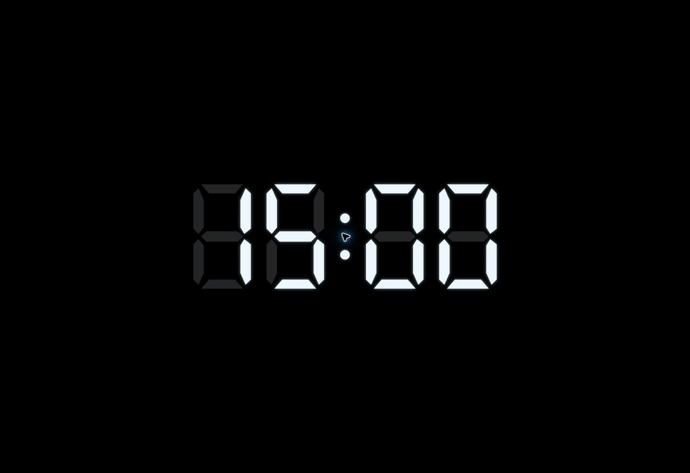
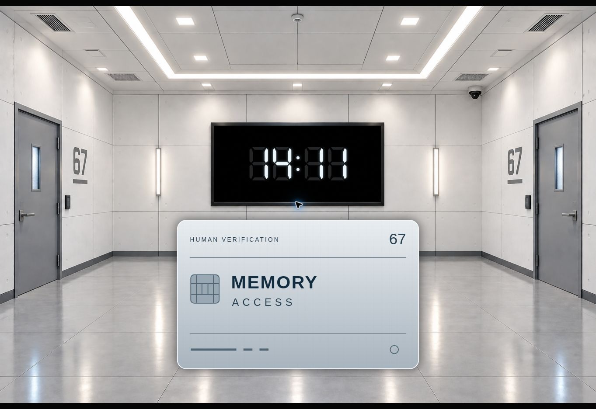

# Human Verification Test #67 — opening cues

開場分支：`feat/one-key-opening`。重新整理頁面即可重跑排練。

開啟 `index.html`，或在資料夾內執行 `python -m http.server 8765`。
整個投影沒有按鈕、滑桿、播放器或狀態列。每次按 **Space**，或點擊／
觸碰畫面一次，推進一個 cue。第一次操作會要求全螢幕；Escape 可退出。

## Cue 順序

初始畫面只有 `Start_dark.PNG`，不會自動播放，也沒有 AI 圖形。

| 次數 | Cue | 行為 |
| --- | --- | --- |
| 1 | 暗 → 亮 | 播放完整 `Start_animation.MP4`；自然播完後回到原本的 `IMG_0165.png`，先不顯示 AI。 |
| 2 | AI 漸顯 | 900 ms 漸顯。初始 X＝50%、Y＝40%、大小＝37%。 |
| 3 | 踢門音效 | 播放設定的音效；音效播完後等待下一個 cue。目前音效尚未提供，此 cue 保留但無聲。 |
| 4 | 歡迎語音 | AI 放大到中央、房間漸暗，播放現有 23.7 秒語音。播完後自動縮小並恢復房間。 |
| 5 | 碼錶取代圖形 | **在歡迎語音播放期間按下**，讓 AI 漸變成七段電子碼錶；先顯示 15:00，不計時。 |
| 6 | 顯示卡片 | 語音播完、畫面縮小完成後，顯示暫用的 MEMORY ACCESS 卡片。 |
| 7 | 隱藏卡片 | 卡片淡出，房間與倒數繼續。 |
| 8 | 全暗 | 1.2 秒內將整個投影淡至純黑。倒數在背景繼續。 |

**倒數只在真正的語音 `ended` 事件發生後開始**，與按第 5 次的時間無關。
語音播完時，不論目前是 AI 或碼錶，都自動回到 X＝50%、Y＝40%、大小＝37%。
若錯過語音期間的碼錶 cue，仍可在語音結束後按第 5 次顯示已開始的倒數，
不會重播語音或重設期限。卡片 cue 會等待語音播完。

影片、漸顯、放大、漸變、縮小及卡片淡入淡出期間，連按不會排隊或跳過。
按住 Space 必須先放開才能進下一個 cue；雙擊的第二下也會忽略。
配置音效後，音效的實際播放期間會鎖住下一個 cue；若音效播放失敗，
下一次按鍵會重試音效。語音失敗則回到語音的重試位置，沒有假倒數。

Y＝40% 指**整個投影畫面高度**；大小＝37% 是原本大小滑桿的比例，
不是圖片寬度的 37%。這兩個數值寫在 `opening-config.js` 的 `idleShape`。
全暗後不再推進新場景；後續記憶房間與辦公室仍待接入。

## 素材

| 素材 | 路徑／狀態 |
| --- | --- |
| 原本亮房間 | `assets/backgrounds/IMG_0165.png`，原檔未修改。 |
| 初始暗房間 | `assets/backgrounds/Start_dark.PNG`，原檔未修改。 |
| 暗亮轉場影片 | `assets/videos/Start_animation.MP4`，完整播放且靜音，原檔未修改。 |
| 歡迎語音 | `assets/audio/ai-opening.mp3`，使用現有版本。 |
| 踢門音效 | **待提供**。放到 `assets/audio/door-kick.mp3` 後，把設定的 `doorKick: null` 改成 `doorKick: "assets/audio/door-kick.mp3"`。 |
| 卡片圖片 | 已有暫用 `assets/cards/memory-access-card.svg`。若提供正式 PNG/JPG，可放在 `assets/cards/`，並更新設定的 `card` 路徑。 |

暫用卡片只顯示劇本已有的 MEMORY ACCESS 與 test 67，不加入角色資料或新線索。
卡片顯示在倒數下方。正式卡片建議橫向約 1.6:1、有透明背景；
踢門音效建議短而獨立的 MP3/WAV，沒有長前置靜音或配樂。

[兩張後續場景的背景提示詞](docs/background-prompts.md) 仍保留。
影片為 16:9、房間圖片為 3:2；各自完整置入，不拉伸或裁切。
素材之間有 240 ms 交接淡化。所有現有執行素材皆為相對路徑，可離線使用；
`doorKick: null` 不會請求不存在的檔案。影片右下角的原有標記仍保留。

## 驗證

```sh
npm test
node --check opening-controller.js
node --check opening-config.js
node --check visualizer.js
```

33 項控制測試涵蓋八段 cue、真正的媒體結束事件、語音中的待命碼錶、
自動縮小、倒數不重設、長按／連按、音效與語音重試及非同步錯誤。

Chrome 畫面與完整實播：

```sh
npm install
npx playwright install chrome
npm run test:browser
```

使用正式 Chrome，以支援原影片的 H.264/AAC。GitHub Actions 會執行
這些測試，並保存 `opening-browser-evidence`：

- 完整影片與完整語音自然播完，音訊確實送入分析器。
- 用像素比對確認暗圖、空的亮房間、Y＝40%／大小＝37%的碼錶、
  卡片顯示／隱藏，以及全暗時所有 RGB 像素皆為 0。
- 三種畫面比例、觸控、Escape、全螢幕拒絕與播放失敗重試。
- 音效欄位使用短 PCM 測試音驗證真實播放與結束，不當成正式踢門素材。

正式演出前仍需在實際電腦、投影機及喇叭上校正亮度與音量。

## 實際預覽畫面

2026-10-10 已在 HTTPS 預覽中用點擊及 Space 跑完全部八個 cue，
確認語音中的 15:00、語音結束後自動縮小與倒數、卡片顯示／隱藏，以及全暗。



