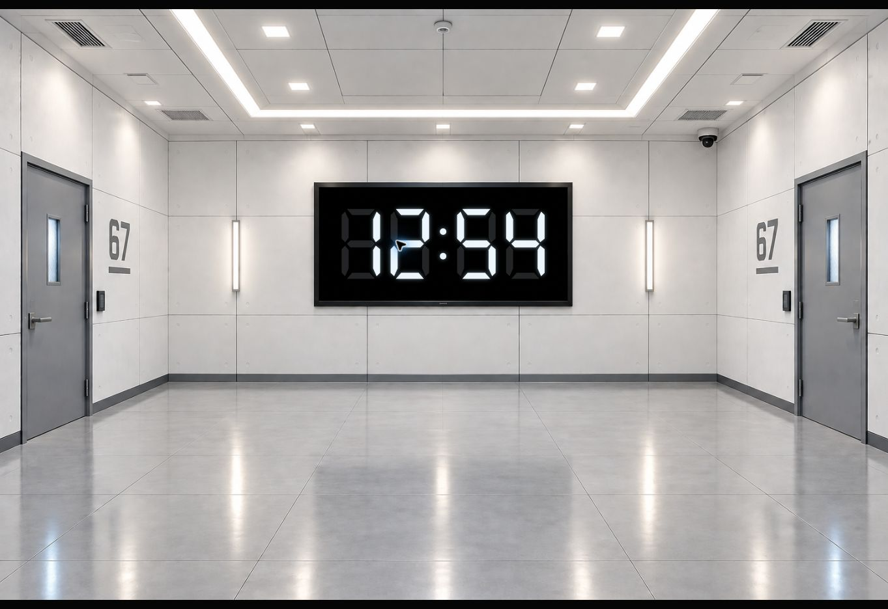

# Human Verification Test #67 - opening

This branch prepares the opening projection for *The Button*.

## Run the opening

Open `index.html` in a desktop browser, or serve this folder with:

```sh
python -m http.server 8765
```

The initial screen contains only `assets/backgrounds/Start_dark.PNG`. The AI
graphic is not shown over this still or the transition video. There are no
buttons, sliders, file pickers, player controls, status bars or fullscreen overlays.

**Click the projection once, or press Space once**, to request fullscreen and
play `assets/videos/Start_animation.MP4`. The entire clip plays once, then its
natural `ended` event reveals the original bright room background,
`assets/backgrounds/IMG_0165.png`, with the small AI graphic inside its wall
monitor. The room stays there until the next cue; no narration or countdown
starts automatically. Clicks and keys during video playback are ignored.

At the opening AI cue, **click or press Space again**. That cue:

1. Starts the bundled English narration and requests fullscreen if needed.
2. Expands the audio-reactive AI graphic while the room fades to black.
3. Waits for the actual audio `ended` event.
4. Fades the AI graphic into a seven-segment clock.
5. Returns the room background and settles the clock inside its wall monitor.
6. Counts down from 15 minutes, ending at `00:00`.

Held keys cannot spill across the video's end into the narration cue. Additional
clicks or keys cannot replay the narration or reset its countdown.
The clock keeps elapsed time when the tab is in the background. Escape exits
fullscreen without stopping the opening or exposing controls. Reload the page to
restart a rehearsal. Later scenes are not yet wired to Space on this branch.

Keys must be sent to the page, rather than the browser address bar. Touching the
projection works as a click, including on its letterbox area.
Fullscreen availability depends on the browser; a rejected fullscreen request
does not stop the narration. Use the actual performance computer and projector
for the final speaker, brightness and browser-permission check.

## Assets and calibration

- `assets/backgrounds/IMG_0165.png`: original bright room background, moved into
  the background folder with its bytes unchanged.
- `assets/backgrounds/Start_dark.PNG`: supplied dark room still, used initially.
- `assets/videos/Start_animation.MP4`: supplied lighting transition, used for
  the first cue. Playback is muted until show sound effects are supplied.
- `assets/audio/ai-opening.mp3`: bundled 23.7-second AI narration, generated for
  this opening. Replace this file with the final recording at the same path.
- `opening-config.js`: asset paths, countdown duration and the monitor rectangle
  expressed as fractions of the background image.

### Uploaded scene materials

- `assets/videos/Start_animation.MP4`: supplied 4.24-second room-lighting
  transition, H.264/AAC, 1280 × 720, 24 fps.
- `assets/backgrounds/Start_dark.PNG`: supplied blue-lit room still,
  1536 × 1024. This is a PNG image, rather than a second video.
- [Background prompts](docs/background-prompts.md): matching memory-room and
  office-flashback backgrounds, with suggested destination filenames.

The supplied files are connected to the first cue without changing their bytes.
The video is 16:9, while both stills are 3:2. Each is contained without stretching
or cropping, with 240 ms fades at the still/video handoffs. The clock calibration
still refers to the original bright image. The video has a small visible mark
in its lower-right corner; use a clean source for the final show.

All runtime assets are included in the folder. The projection has no CDN,
external font, speech-service or network dependency. The opening narration is:

> Welcome to human verification test number sixty-seven. Please remain calm.
> There is no escape. You have one mission. There is one robot in this room.
> Find out who. When you have decided, press the button. Or else, everyone will
> be executed. You have fifteen minutes.

## Checks

The media and countdown controller is tested independently of the renderer:

```sh
node --test tests/opening.test.cjs
node --check visualizer.js
```

The 22 tests cover separate room and narration cues, actual end-event gating,
duplicate and pending presses, click filtering, playback failure and retry,
media errors, skipped frames, clock boundaries and keyboard shortcuts.

For the real Chromium playback and projection checks:

```sh
npm install
npx playwright install chromium
npm run test:browser
```

## Browser verification

The current browser checks compare the initial canvas pixels with the supplied
dark PNG and the final room with the original bright PNG. They play both the
complete video and the complete narration to their natural ends, and check
clicks, held Space across the video end, no automatic narration, double-clicks,
touch, fullscreen rejection, video/audio failure retries, layout and hidden
controls. Screenshots and results are uploaded as `opening-browser-evidence`.

### Original narration evidence

[GitHub checks on 2026-10-10](https://github.com/mymcworld3-droid/Ai-shape/actions/runs/38042553950)
passed both jobs: 13 controller tests and Chromium browser checks. The browser
played the complete MP3 to its natural end and verified real audio analyser
samples, fullscreen, automatic countdown, repeated keys, Escape, 1920x1080,
1440x900 and 390x844 layouts, fullscreen rejection and playback failure/retry.
The `opening-browser-evidence` artifact contains the waiting, narration and
countdown screenshots plus the browser results.

The projection was also inspected in a live browser with no player controls or
buttons, including a held Space press during narration and again during countdown.


