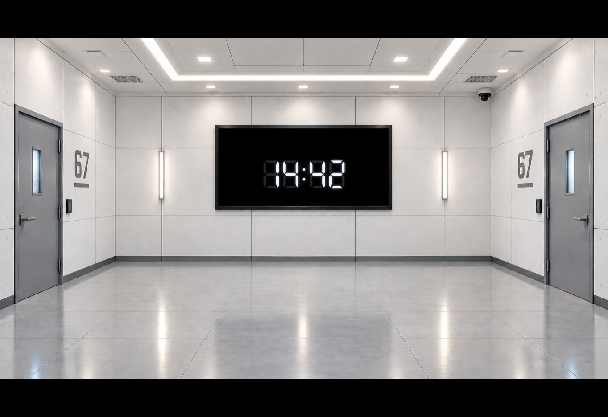
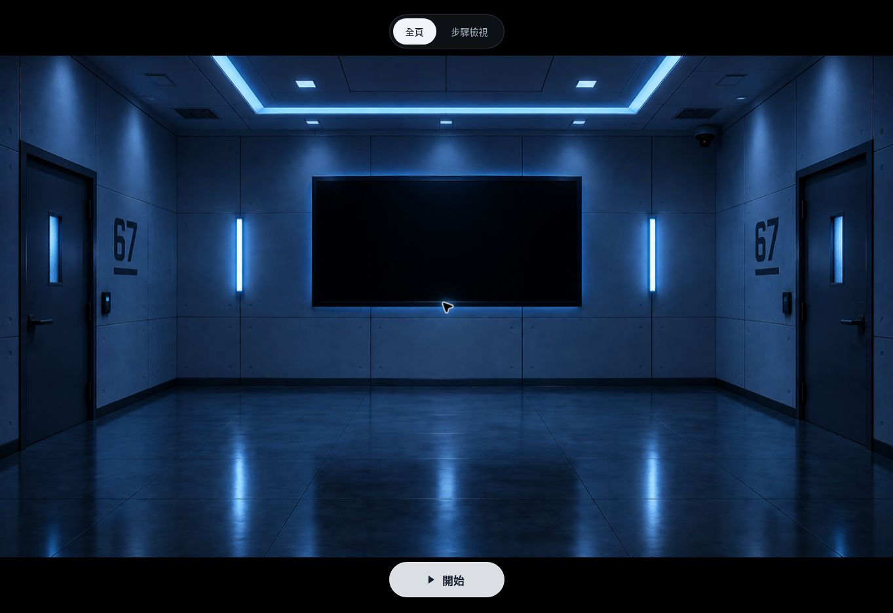
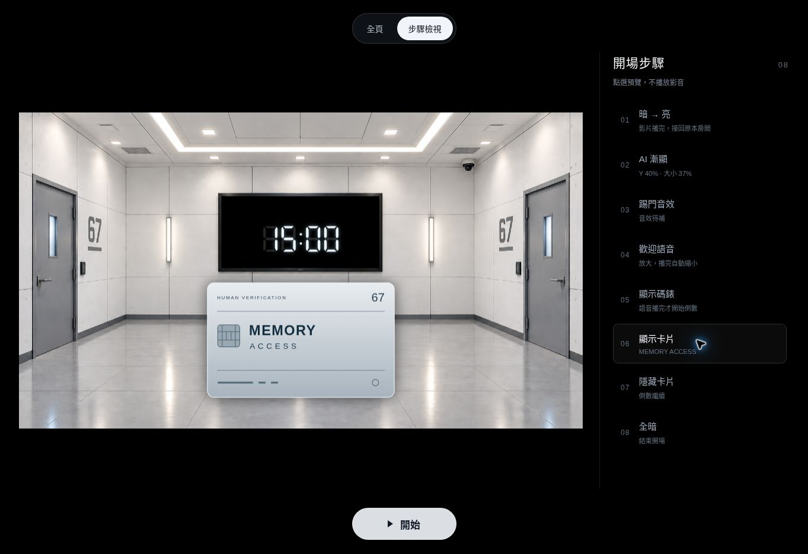
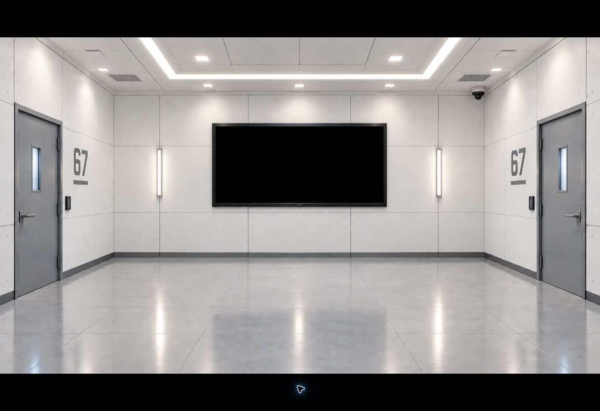

# Human Verification Test #67 — stage cues

開場分支：`feat/one-key-opening`。重新整理頁面即可重跑排練。

開啟 `index.html`，或在資料夾內執行 `python -m http.server 8765`。
開始前有 **全頁／步驟檢視** 與螢幕底部固定漂浮的 **開始** 鍵。
只有按下「開始」才會播放第一段影片，並隱藏所有檢視按鍵；
之後每次按 **Space**，或點擊／觸碰畫面一次，推進一個 cue。
開始時會要求全螢幕，Escape 可退出；退出後也不會重新顯示按鍵。

## 16:9 與檢視模式

- **全頁**：在整頁顯示固定 16:9 投影畫框，初始是 `Start_dark.PNG`。
- **步驟檢視**：列出二十五段 cue，包括開場八段、記憶室四段、第二幕六段與第三幕七段。
  點選步驟可預覽房間、AI、碼錶、卡片或全暗；
  圖形步驟會播放 1.5 秒漸顯，重點同一步可重播；
  不播放影片／音效／語音，不啟動倒數。
- **開始**：固定漂浮在螢幕底部，素材備妥後才可按。
  無論先預覽到哪一段，按下後都從第 1 段開始，而不是跳到預覽的步驟。
- **播放後**：只有投影畫面，所有檢視按鍵及步驟列表皆隱藏。
  重新整理才能回到檢視模式。

畫框在全頁、步驟檢視、全螢幕及手機上都維持 **16:9**。
背景與影片採 **cover** 等比例填滿畫框，超出部分置中裁掉，不拉伸、
不在畫框內留下圖片黑邊。若螢幕不是 16:9，畫框外保留黑色空間，
不會把投影畫面改成手機的直立比例。投票碼錶的 Y＝40% 以這個 16:9 畫框為準。

待機時，第一場 AI 以原背景的**電視黑色內框**定位，隨背景 cover 裁切一起換算，
固定在電視正中央。主圖形以固定尺寸放到最大，留極小內距；
六邊形與主圖形發光限制在內框中，光點集中在主圖形外側的環帶。波形基準圈固定，保留原振幅，
允許超過電視及圖形邊界；超出 16:9 畫面的部分直接裁掉，不隨音量縮小。
所有 AI 語音開始真正播放時，**只有圖形放大到畫面前方**。
原房間保持構圖與裁切位置，逐漸暗至全黑；播完恢復原亮度、圖形縮回。
開場、記憶室歡迎及第三幕四段配音使用同一效果，圖形維持比例並保留字幕空間。
第三幕配音期間碼錶讓位給圖形，配音結束後恢復倒數，不重設期限。
語音尚未提供時保留靜音 cue；開始前可預覽播放時的放大圖形。

## Cue 順序

初始投影只有 `Start_dark.PNG`，不會自動播放，也沒有 AI 圖形。
表中第 1 段由「開始」鍵觸發；第 2–25 段沿用 Space 或點擊推進。

| 次數 | Cue | 行為 |
| --- | --- | --- |
| 1 | 暗 → 亮 | 播放完整 `Start_animation.mp4`；自然播完後回到原本的 `IMG_0165.png`，先不顯示 AI。 |
| 2 | AI 漸顯 | 1500 ms 漸顯，置於電視內框正中央，依內框可容納的最大尺寸顯示。 |
| 3 | 踢門音效 | 播放設定的音效；音效播完後等待下一個 cue。已接上使用者提供的踢門 WAV，約 0.51 秒。 |
| 4 | 歡迎語音 | AI 圖形放大到前景，原房間保持構圖並漸暗；播放最新 29 秒語音。播完圖形縮回、恢復房間亮度。 |
| 5 | 碼錶取代圖形 | **在歡迎語音播放期間按下**，讓 AI 漸變成七段電子碼錶；先顯示 15:00，不計時。 |
| 6 | 顯示卡片 | 語音播完、畫面縮小完成後，顯示暫用的 MEMORY ACCESS 卡片。 |
| 7 | 隱藏卡片 | 卡片淡出，房間與倒數繼續。 |
| 8 | 全暗 | 1.2 秒內將整個投影淡至純黑。倒數在背景繼續。 |
| 9 | 記憶室亮起 | 演員說完「Where's the light?」時按下。從全暗淡入記憶室，上一幕的碼錶、卡片與 AI 全部退場。開燈音效待補。 |
| 10 | 記憶室 AI | 在「Scary.」之後按下。AI 在 Y＝40% 漸顯；配置歡迎語音後，圖形放大、原背景漸暗，播完縮回。語音待補，不重播開場語音。 |
| 11 | 演員對話 | AI 退場，只留下記憶室。停留到演員對話結束，不自動切走。若已配置語音，AI 在真實語音播完後先自動淡出，這一按仍保留。 |
| 12 | 記憶室全暗 | 演員說完「Go ahead.」且準備轉幕時按下，1.2 秒全暗。 |
| 13 | Christopher 獨白 | 演員走到中央，記憶室以 65% 亮度淡入；停留到第一句台詞結束。 |
| 14 | 只留中央追光 | 第一段獨白停頓時按下，投影淡至全暗；實際舞台保留中央追光。 |
| 15 | 辦公室回憶 | 說完 Liam，演員進入回憶時按下，1 秒淡入明亮辦公室，停留供演員對話。 |
| 16 | BANG · Ben 進場 | Christopher 說完「I…」時按下；音效待補，保留辦公室。 |
| 17 | Christopher 自白 | Liam、Ben、Boss 離場後按下，辦公室淡至全暗，實際舞台保留中央追光。 |
| 18 | 回到記憶室 | 自白最後一句結束、燈光恢復時按下，1 秒淡回記憶室，停留等待第三幕。 |
| 19 | 演員討論 | 第三幕開場時按下，記憶室稍暗、保留 80% 亮度，等待演員討論。 |
| 20 | AI 要求選擇 | Christopher 按下實體按鈕時按下，顯示選擇提示；語音待補。 |
| 21 | 一分鐘倒數 | 顯示獨立 01:00 碼錶。語音配置後在真實提示播完時計時；目前語音未提供，以此按鍵啟動。 |
| 22 | Ethan 一票 | Christopher 說 Ethan. 後按下，顯示 Subject Ethan / One vote，對應語音待補。 |
| 23 | Ethan 兩票 | Megan 說 Ethan. 後按下，顯示 Subject Ethan / Two votes，對應語音待補。 |
| 24 | 最後選擇 | Ethan 說 Rachel?、Rachel 沒有回答之後按下，顯示最後選擇提示，語音待補。 |
| 25 | 第三幕全暗 | 最後提示結束後按下，1.2 秒全暗，等待第四幕。 |

**倒數只在真正的語音 `ended` 事件發生後開始**，與按第 5 次的時間無關。
語音播完時，AI 縮回原背景的電視中央與內框尺寸；若目前顯示碼錶，
則自動縮回原電視內框的正中央，以數字和光暈不越框的最大等比例尺寸顯示。
若錯過語音期間的碼錶 cue，仍可在語音結束後按第 5 次顯示已開始的倒數，
不會重播語音或重設期限。卡片 cue 會等待語音播完。

影片、漸顯、放大、漸變、縮小及卡片淡入淡出期間，連按不會排隊或跳過。
按住 Space 必須先放開才能進下一個 cue；雙擊的第二下也會忽略。
配置音效後，音效的實際播放期間會鎖住下一個 cue；若音效播放失敗，
下一次按鍵會重試音效。語音失敗則回到語音的重試位置，沒有假倒數。

Y＝40% 指**整個投影畫面高度**；大小＝37% 是原本大小滑桿的比例，
不是圖片寬度的 37%。這兩個數值寫在 `opening-config.js` 的 `idleShape`，
目前用於投票碼錶及記憶室 AI 的待機中心。開場 AI 與碼錶使用 `roomScreen`：
原圖黑色內框為 x＝552、y＝310、寬＝430、高＝195 像素，內距 2 像素。
放大的圖形脫離原電視內框，只有圖形改變大小；背景中原有的電視保持原樣。
投票圖形不超過畫框高度 78%，下方字幕保留空間。
第一場全暗後可按下一鍵進入記憶室。第二場全暗後沿用同一鍵進入第二幕。
每段演員對話都等待新按鍵；第三幕結束後停留全暗，第四幕尚未接入。
跨場不重播開場影片／語音，也不暫停或重設原本的十五分鐘期限。
記憶室與辦公室不顯示碼錶，期限仍在背景繼續。追光需由實際舞台燈配合。
第三幕投票另有一分鐘碼錶，以 X＝50%、Y＝40%、大小＝37% 顯示。
它不覆寫原本十五分鐘期限，歸零只停在 00:00，不代替演員投票或自行切幕。

[記憶室操作時機、素材清單與背景生成提示詞](docs/memory-room.md)。
[AI 圖形放大與最新驗證畫面](docs/ai-screen.md)。
[第二幕操作時機、素材清單與辦公室生成提示詞](docs/office-memory.md)。
[第三幕操作時機與四段待補語音](docs/voting.md)。

## 素材

| 素材 | 路徑／狀態 |
| --- | --- |
| 原本亮房間 | `assets/backgrounds/IMG_0165.png`，原檔未修改。 |
| 初始暗房間 | `assets/backgrounds/Start_dark.PNG`，原檔未修改。 |
| 暗亮轉場影片 | `assets/videos/Start_animation.mp4`，使用最新上傳的 4.27 秒版本，完整播放且靜音，原檔未修改。檔名大小寫須與設定一致。 |
| 歡迎語音 | `assets/audio/ai-opening.m4a`，使用最新上傳的 29 秒 AAC 原檔。 |
| 踢門音效 | 已有 `assets/audio/door-kick.wav`，使用者提供的原始 WAV，約 0.51 秒；第 3 步播放，真正結束後等待下一次按鍵。 |
| 卡片圖片 | 已有暫用 `assets/cards/memory-access-card.svg`。若提供正式 PNG/JPG，可放在 `assets/cards/`，並更新設定的 `card` 路徑。 |
| 記憶室背景 | 已有 `assets/backgrounds/memory-room.png`，和原亮房間一樣明亮，只保留左側一扇門；左後方相框留白。 |
| 記憶室歡迎語音 | **待提供**：Welcome to the Memory Room. 設定在 `memory.narration`。 |
| 記憶室開燈音效 | **待提供**：短 click。設定在 `memory.lightClick`。 |
| 辦公室背景 | 已有 `assets/backgrounds/office-memory.png`，明亮企業辦公室、左後方辦公桌、中央留白。 |
| 辦公室 BANG 音效 | **待提供**：`assets/audio/office-bang.mp3`，設定在 `office.bang`；與開場踢門 cue 分開。 |
| 相框道具 | Christopher 與 Liam 合照及背面題字由演員道具提供；背景內不虛構角色照片。 |
| 第二幕道具 | 實際文件／資料夾供 Christopher、Liam、Boss 使用；需要演員操作的桌子另備實體。 |
| 第三幕語音 | **待提供**：選擇提示、Ethan 一票、Ethan 兩票、最後選擇，共四段；精確台詞與檔名見 `docs/voting.md`。 |
| 第三幕背景 | 沿用現有記憶室，不需新增背景或影片。 |

暫用卡片只顯示劇本已有的 MEMORY ACCESS 與 test 67，不加入角色資料或新線索。
卡片顯示在倒數下方。正式卡片建議橫向約 1.6:1、有透明背景；
踢門音效建議短而獨立的 MP3/WAV，沒有長前置靜音或配樂。

[兩張後續場景的背景提示詞](docs/background-prompts.md) 仍保留。
影片為 16:9、房間圖片為 3:2；皆填滿 16:9 畫框，超出部分裁掉、不拉伸。
素材之間有 240 ms 交接淡化。所有現有執行素材皆為相對路徑，可離線使用；
踢門音效與開場語音都使用專案內檔案，不依賴外站連線。影片右下角的原有標記仍保留。

## 驗證

```sh
npm test
node --check opening-controller.js
node --check opening-config.js
node --check visualizer.js
```

84 項控制與版面測試涵蓋 16:9、cover 裁切、電視內框定位與最大尺寸、靜音步驟預覽、開始閘門、
八段 cue、真正的媒體結束事件、語音中的待命碼錶、自動縮小、
倒數不重設、長按／連按、音效與語音重試及非同步錯誤。
記憶室測試另外涵蓋素材載入閘門、淡入不能跳過、兩個獨立音訊重試、
真正語音結束後 AI 退場，以及二十五個 cue 跨場不重設期限。
第二幕另外驗證六個手動 cue、BANG 的真正結束與獨立重試、長按不排隊、
晚到的非同步錯誤、背景載入閘門及結束後停留記憶室。
第三幕再驗證四段語音各自的結束與重試、一分鐘期限獨立、
缺語音時只在手動碼錶 cue 啟動，以及歸零不自動投票或切幕。

Chrome 畫面與完整實播：

```sh
npm install
npx playwright install chrome
npm run test:browser
```

使用正式 Chrome，以支援原影片的 H.264/AAC。GitHub Actions 會執行
這些測試，並保存 `opening-browser-evidence`：

- 完整影片與完整語音自然播完，音訊確實送入分析器。
- 開始前點投影或按 Space 都不播放，檢視二十五段步驟也不播放；
  按「開始」才播第一段並移除所有可見／可操作的檢視按鍵。
- 用獨立的 cover 像素比對確認暗圖、空的亮房間、原電視中央且盡量填滿的開場碼錶、
  卡片顯示／隱藏，以及全暗時所有 RGB 像素皆為 0。
- 三種畫面比例、觸控、Escape、全螢幕拒絕與播放失敗重試。
- 圖形整體縮放不隨音量改變；內部六邊形與波形恢復隨音量變化。前景為前版約 82%，劇情仍控制放大與縮回。
- AI 靜態、真實語音及最大音量頻譜皆逐像素比對，確認外圈、粒子及發光
  待機對準原電視，語音中圖形放大；原背景維持構圖並漸暗，三種畫面比例均涵蓋。
- 音效欄位使用短 PCM 測試音驗證真實播放與結束，不當成正式踢門素材。
- 從開場實播一路進入記憶室，逐像素確認房間背景，排除上一幕的碼錶／卡片；
  三種螢幕比例皆填滿且保持 16:9，對話停留與第二次全暗仍不重設期限。
- 記憶室語音與開燈音效使用 PCM 測試音驗證真實結束、失敗重試與 AI 自動退場；
  正式設定維持 `null`，不以測試音代替正式素材。
- 第二幕依劇本順序保留獨白、辦公室、BANG、自白與回到記憶室，
  獨立像素比對確認暗化、純黑及三種螢幕比例的背景填滿。
- 辦公室 BANG 以 PCM 測試音檢驗真實結束、獨立重試與長按限制；
  背景未載入時無法開始，載入成功不會自行播放。
- 第三幕實際投影檢查稍暗房間、一票／兩票不同文字、三種比例的碼錶位置與大小、
  精確全暗及兩個期限各自持續；四段語音均以測試服務限定的 PCM 音檢驗真實播放與重試。

正式演出前仍需在實際電腦、投影機及喇叭上校正亮度與音量。

2026-10-12：第二步 AI 改為 1.5 秒漸顯，步驟檢視也播放淡入；重點同一步可重播。
背景尚未載入時，先保持透明，圖片能繪製後才開始淡入。版本 `f964a00` 的
84 項控制／版面測試及 19 組
[Chrome 檢查](https://github.com/mymcworld3-droid/Ai-shape/actions/runs/38192886226)
全部通過，新增像素量測確認預覽與正式播放確實經過透明、中間濃度及完整顯示，
並涵蓋延遲載入、重播、切換取消及開始時重設。三階段畫面見 [AI 漸顯驗證](docs/ai-screen.md)。

2026-10-12：開場碼錶縮回原背景電視的正中央，依內框放到最大、光暈不越框。
所有配音放大時的原背景漸暗至全黑。版本 `252d0a7` 的 82 項控制／版面測試與
18 組 [Chrome 實播檢查](https://github.com/mymcworld3-droid/Ai-shape/actions/runs/38190776743)
通過，三種比例均獨立驗證碼錶居中、寬度超過內框 95%、全部像素不越框，
並確認放大時背景像素為純黑。最新畫面見 [AI 與碼錶定位](docs/ai-screen.md)。

2026-10-12：所有 AI 配音統一為只有圖形放大，原背景維持構圖並漸暗至 25% 亮度。
語音真正播完後圖形縮回、背景恢復原亮度；投票恢復討論時的 80% 亮度。
版本 `ea7847e` 的 79 項控制／版面測試與 18 組
[Chrome 實播檢查](https://github.com/mymcworld3-droid/Ai-shape/actions/runs/38189682656)
全部通過，獨立像素比對確認背景未移動，圖形在三種比例下均保持邊界與字幕空隙。
最新實播與靜音預覽見 [AI 圖形放大](docs/ai-screen.md)。

2026-10-12：開場語音改用最新上傳的 `assets/audio/ai-opening.m4a`，
29 秒、AAC、44.1 kHz 雙聲道，檔案原樣沿用。舊 MP3 已移除。
版本 `ffb0049` 的 75 項控制測試與 18 組
[Chrome 檢查](https://github.com/mymcworld3-droid/Ai-shape/actions/runs/38186113154)
全部通過，包含新 M4A 完整自然播放、真正結束後才開始倒數、
AI 自動縮小及各幕流程。HTTPS 預覽另以開始鍵及 Space 實播，
確認來源為新 M4A、長度 29 秒、結束時間 29 秒、所有按鈕隱藏。



2026-10-12：記憶室與第三幕配音新增 AI 播放時放大、播完縮小及碼錶恢復。
版本 `ab9aec1` 的 75 項控制測試與 18 組
[Chrome 檢查](https://github.com/mymcworld3-droid/Ai-shape/actions/runs/38183603121)
通過，包括五段真實 PCM 播放的放大幅度、音訊分析、結束後縮小、
兩個期限不變及三種比例的圖形／字幕分離。靜音放大預覽見 [第三幕](docs/voting.md)。

2026-10-11：第二、三幕已接入。版本 `90e266b` 的 73 項控制／版面測試與
17 組 [Chrome 檢查](https://github.com/mymcworld3-droid/Ai-shape/actions/runs/38144886327)
全部成功；另在 HTTPS 預覽用 Space 跑完 25 步，開始後所有按鈕隱藏，
原影片與開場語音各自然播完一次。實際投影與四段待補語音見 [第三幕](docs/voting.md)。

## 16:9 與檢視模式實際畫面

2026-10-10：42 項控制／版面測試與完整 Chrome 實播測試均通過。
也在 HTTPS 預覽中確認：卡片步驟預覽時影音時間皆為 0；
點投影不會開始。按底部「開始」後從暗亮影片播放，
自然播完接回亮房間，所有按鍵與步驟列表均隱藏。





## 前一版語音／卡片驗證畫面

下圖保留 16:9 與開始鍵改版之前的畫面。2026-10-10 曾在 HTTPS 預覽中
用點擊及 Space 跑完全部八個 cue，
確認語音中的 15:00、語音結束後自動縮小與倒數、卡片顯示／隱藏，以及全暗。


圖形尺寸固定修正（`0a1af7b`）：[84 項控制／版面測試與 20 組 Chrome 檢查](https://github.com/mymcworld3-droid/Ai-shape/actions/runs/38194259010)通過。
靜音、中等、最大音量與恢復靜音時，圖形中心、縮放比例與外圈半徑完全一致，內部波形仍反應音訊。

縮小前景與恢復聲音反應（`605ccb5`）：[84 項控制／版面測試與 20 組 Chrome 檢查](https://github.com/mymcworld3-droid/Ai-shape/actions/runs/38195567086)全部通過。

波形完整振幅與固定基準圈（`93f95b9`）：[84 項控制／版面測試與 21 組 Chrome 檢查](https://github.com/mymcworld3-droid/Ai-shape/actions/runs/38197015897)全部通過。

光點外移（`3bfba11`）：[84 項控制／版面測試與 22 組 Chrome 檢查](https://github.com/mymcworld3-droid/Ai-shape/actions/runs/38513986179)全部通過。

## 踢門音效（2026-10-14）

第 3 步播放 `assets/audio/door-kick.wav`；原檔取自
[使用者指定的 249.wav](https://downsc.chinaz.net/files/download/sound/huang/cd9/wav/249.wav)。
WAV 為 44.1 kHz、16-bit、雙聲道 PCM，22,500 幀，長度 0.510204 秒、90,044 bytes。
檔案未剪輯或轉碼，SHA-256：`4385817b7ba8a163fe9feb70d0da9861b92e4bdb4636e58649581e717d50c655`。
播放期間禁止切到歡迎語音；真正結束後仍停在踢門 cue，放開按鍵再按一下才進入第 4 步。
播放失敗時下一次按鍵只重試踢門音效，不會跳到語音或開始倒數。
