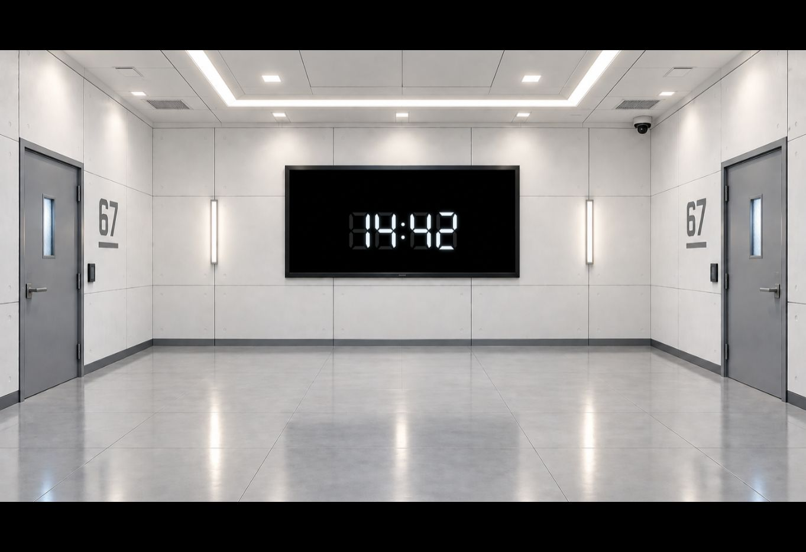
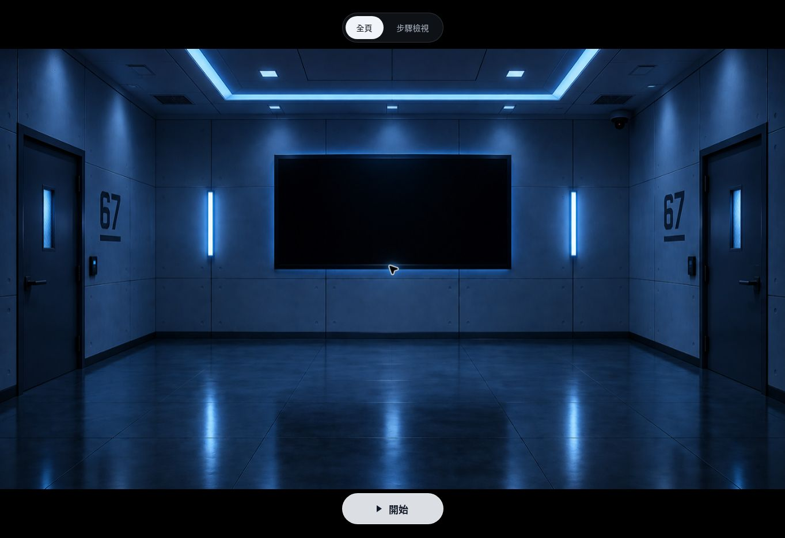
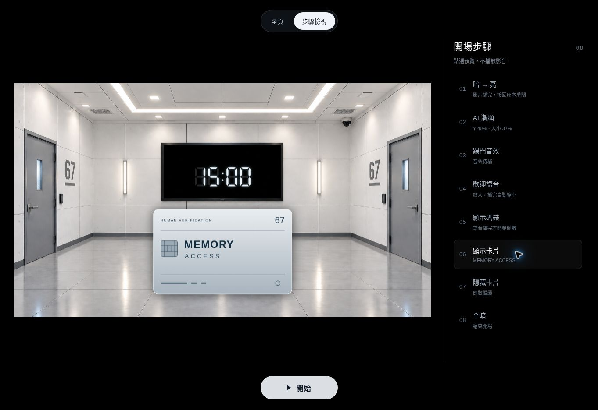
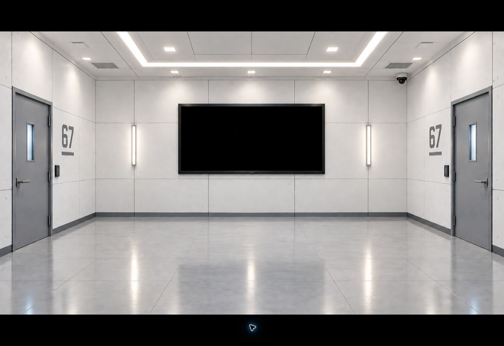
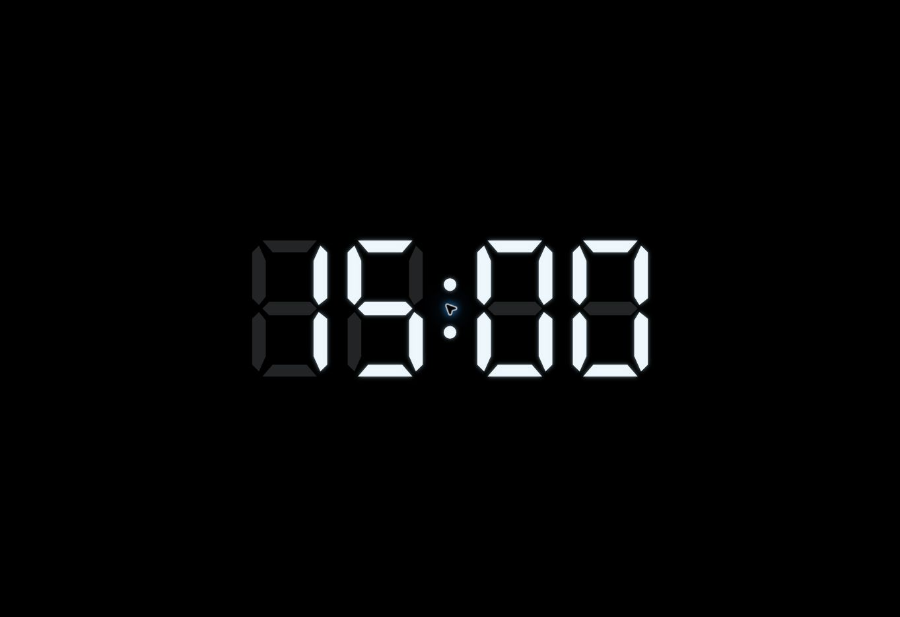
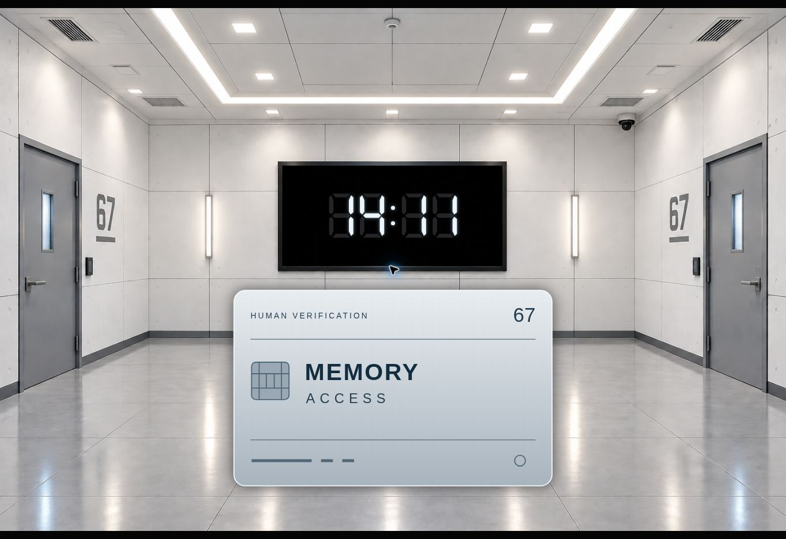
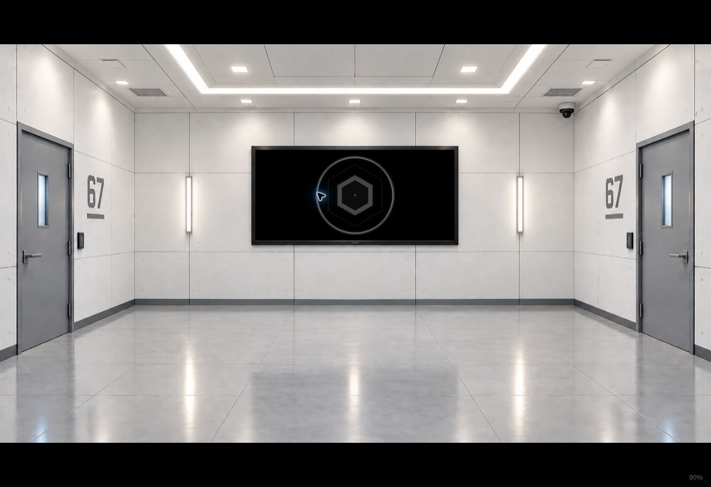

# Human Verification Test #67 — stage cues

目前預設為**四幕完整劇本字幕模式**：空白鍵／→／單擊下一步，← 上一步，1／Q 語音、2／W 音效、3／E 背景音樂、O 顯示／隱藏音量，F 開始。
`script-data.js` 保留原來的完整逐句／配音提示資料；`subtitle-data.js` 根據最新 [Google Docs 劇本](https://docs.google.com/document/d/1-H-BsGu7qU9mnTh16ewinHN58a3nB62pHX-B0Wv5hLs/edit) 在字幕模式補齊遺漏台詞、排除純狀聲詞並合併沒有其他操作步驟隔開的同角色台詞。原有黑幕、音效、配樂、照片翻轉與 AI 配音門檻均保留；獨立的幕後花絮步驟已刪除；合併後步數以畫面實際顯示為準。
[字幕模式及劇本核對](docs/subtitles.md)。
開始前可切回獨立的 **41 步場景模式（編號 0–40）**；該模式 AI 語音仍保留逐句提示，不受字幕合併影響。兩種模式都在最終全黑之後直接顯示六張片尾字幕，已移除幕後花絮，前五張分別停留 3.0、2.8、2.8、2.7、7.0 秒。


劇場投影與手動 cue 控制。重新整理頁面即可重跑排練。

開啟 `index.html`，或在資料夾內執行 `python -m http.server 8765`。
開始前有 **全頁／步驟檢視** 與螢幕底部固定漂浮的 **開始** 鍵。
只有按下「開始」才會開始逐句流程，並隱藏所有檢視按鍵；
之後每次按 **Space／→**，或點擊／觸碰畫面一次，推進一個 cue。
**←** 返回上一個步驟；**1／Q** 提高／降低語音、**2／W** 提高／降低音效、**3／E** 提高／降低背景音樂（每次 5%），**O** 切換右下角三組音量顯示。
素材載入完成後也可按 **F** 開始；開始後再按 F 不會重播或跳步。
開始時會要求全螢幕，Escape 可退出；退出後也不會重新顯示按鍵。


## 六張片尾字幕（依據 Directed by.pdf，2026-11-12）

片尾直接接在「最終全黑」之後，**沒有幕後花絮步驟或額外黑幕**。場景模式的六張片尾為第 35–40 步；字幕模式也使用同一份 `EndCredits.cards`。在場景第 34 步（字幕模式第 263 步）進入最終全黑後，`Ending.mp3` 延遲 1 秒從頭播放，再依歌曲實際播放時間 **1.6 秒自動進入第一張片尾**。接下來五張字幕各停留 3.0、2.8、2.8、2.7、7.0 秒，進場、展示與退場動畫都包含在各自時限內；最後切換至第 40 步〈The Button〉，縮小動畫結束後停留直到操作員返回或跳轉。

開始前的步驟預覽仍不計時、不播放音訊，可從指定步驟開始。演出期間可按上一／下一步提早跳過，亦可由 `remote.html` 搜尋並跳轉；每次跳轉都會取消舊倒數並依新卡片時長重新計算。第 34 步的自動換頁採用 `Ending.mp3` 的實際播放 `currentTime`，而不是估計的點擊時間；音樂尚未成功開始或已暫停時不會誤跳。手動返回第 34 步會從頭重新播放歌曲並重新同步；原有聲音與其他場景功能不受影響。


**從 Ending.mp3 真正開始播放起算：** 第 35 步 1.6s；第 36 步 4.6s；第 37 步 7.4s；第 38 步 10.2s；第 39 步 12.9s；第 40 步 19.9s。

**片尾歌曲只播放一次：** `assets/audio/background/Ending.mp3` 設定 `loop: false`；播放完自然停止，不會自動從頭重播。跨片尾字幕步驟共用同一首歌，不因字幕自動切換而重啟；只有使用者明確返回最終全黑並重新開始該段，才會刻意重播。

1. **Directed by** — SOPHIA CHOU / CURRY CHEN / RICKY LIU：由下方上浮與聚焦淡入，離開時向上飄散。
2. **Based on the conversation between** — CHAT GPT / SOPHIA CHOU：橫向遮罩滑入，離開時向右抽離。
3. **Produced by** — SOPHIA CHOU：由略大、失焦狀態凝聚，離開時向中心縮小淡出。
4. **Executive producers** — CURRY CHEN / RICKY LIU：立體翻入，離開時旋轉退場。
5. **Backgrounds** — MUSICS — SHIU-CHEN JOU / IMAGE — RAY CHEN：橫向展開，離開時字距散開並下移。
6. **The Button** — 黑底，白色 The + 暗紅色高窄字 Button；以 `scale(160)` 模擬從極遠大處壓入，**最初 0.5 秒由極快速縮小連續減速**，接著從 `scale(2.3)` **改成固定速度**，直至整段 4.7 秒結束時定格為 `scale(1)`。僅此一次速度切換，不會再二次減速。

前五步的進場與退場動畫各有不同的參數與軌跡，並在各自 3.0、2.8、2.8、2.7、7.0 秒的時段內完成，隨後自動換頁。使用「減少動態效果」設定時即時呈現最終文字版面。片尾以 DOM 字型在 16:9 投影內繪製，尺寸可跟隨全螢幕及行動裝置縮放，不依賴 PDF 截圖。

## 記憶室相框照片（2026-11-12）

第一幕第二場加入兩張實拍圖片，均已存放在 `assets/cards/Frame-front.png`、`assets/cards/Frame-back.png`，保留原圖，沒有使用 AI 重畫人臉或簽名。

- **逐句字幕模式**：原稿 p122「Is this...」開始出示合照正面；p137「There's also some writing on the back.」切換手寫背面；p143「Who's that with you?」暫時切回合照；p149 起返回記憶室背景。字幕依舊由操作員逐句切換，圖片不額外佔一步。
- **場景模式**：原記憶室「演員對話」後插入三個手動 cue：13「正面合照」、14「背面留言」、15「收起相框」，原「記憶室全暗」順延為第 16 步，其後所有步驟順延 3。支援步驟預覽與遠端操控。
- 圖片投影時等比例置中、逐漸暗化記憶室背景。正面合照以 650 ms 淡入微放大、正反面以 820 ms 翻頁（至中線才切圖，手寫字不反轉）、隱藏時以 460 ms 淡出縮小；回上一張照片也會反向翻面。使用系統「減少動態效果」時立即切換。保留原圖、劇本台詞與配樂。

## 多裝置線上操控

使用 Node.js 22 以上執行 `npm ci` 和 `npm start`。部署時請使用支援 WebSocket 的 Node 網站服務（例如 Render Web Service），所有裝置開啟**同一個網站網址**，不需在同一個 Wi-Fi 內。

1. **播放裝置**：開啟首頁、選好演出模式與步驟，按「開始」。這台裝置自動成為唯一的播放端，負責所有畫面、影片及音效。
2. **其他手機／電腦**：開啟同一個網站，點「操控頁面」，或直接開啟 `/remote.html`。不用配對；即使在播放前先進入操控頁面，也會等待播放端開始。
3. 任何已連線的操控端都能切換上／下一步、調整三組音量及切換音量顯示，也能按「☷ 步驟清單」搜尋、檢視並點選任意步驟直接跳轉。清單標記目前步驟，場景模式的名稱取自播放端原始清單，逐句字幕則使用相同劇本資料。所有操控端會收到最新進度，操控端本身不播放演出聲音或影片。
4. 跳轉時立即停止上一段語音、音效或影片，直接套用目的步驟的畫面與媒體，不逐一執行被略過的 cue。若跳進同一段錄音的中間台詞，原錄音會從頭播放（尚無逐句音訊時間碼）。主操控畫面維持不捲動，步驟清單另外以可搜尋的視窗顯示。
5. 播放端關閉、重新整理或斷線時，操控端暫停操作；另一台裝置按「開始」後可接手。暫時斷線會嘗試重新連線。

「配對」按鈕仍保留原有的專用配對網址功能，作為進階備用方案。公開操控頁面不使用密碼，**任何能開啟此網站的人都能操作正在播放的演出**，請只在可信任的團隊內分享網址。使用多個 Render 執行個體時應設定單一服務執行個體，讓所有 WebSocket 連到相同的記憶體內同步狀態；單純 GitHub Pages 或 `python -m http.server` 不支援線上操控。

### 遠端語音的自動重試

若播放裝置的瀏覽器暫時拒絕遠端指令觸發 AI 語音（`NotAllowedError`），系統會在原場景或原逐句字幕步驟自動重試最多兩次（約 450 ms、1,200 ms），不更換台詞、不重啟倒數；所有控制端會看到重試提示。播放成功後提示自動消失。

若連續失敗，僅在此時顯示播放裝置上的「啟用語音並重試」按鈕。瀏覽器的自動播放授權屬於安全限制，無法靠計時器或另一台裝置的點擊繞過，必要時仍須在播放裝置互動一次。

### 場景／字幕模式的提前提示、步驟控制與音訊電平

遠端原有「下一步預告」已改成「步驟前後預覽」，以**即將進入的下一步**為中心，顯示其**前兩步、目標步驟、後兩步**（最多五個連續操作步驟）。例如現在正演第 30 步、下一步為第 31 步時，預覽範圍就是 29–33 步。每行帶有真實步驟編號及角色／台詞，目前正在執行的步驟與接下來要切換的步驟分別醒目標示；演出開始或結尾若不足五步，僅顯示存在的步驟。內容隨投影端進度、上一／下一步、遠端跳轉及斷線重連同步更新。**場景模式**依實際場景 cue 與劇本原始段落顯示場景名稱及相應台詞；**逐句字幕模式**依 `SUBTITLE_SCRIPT.entries` 的合併字幕順序，一步對應一個真實操作步驟，純音效／畫面步驟則顯示該步驟說明，不將前後台詞錯當作同一步。手機版仍維持單畫面、不捲動的操控版面。

兩種模式也都保留上一步、下一步和「☷ 步驟清單」：可搜尋全部步驟、查看目前位置，直接點選跳至指定步驟。

三組音量以 **0–100% 滑桿**直接調整播放裝置的語音、音效、背景音樂；原有 1/Q、2/W、3/E 快捷鍵不受影響。每組滑桿下方另設即時電平表，顯示播放端音訊的實際 RMS 輸出強度（-60～0 dBFS，每秒約更新 8 次），靜音或未播放時顯示「靜音」。這是瀏覽器內音訊訊號的測量，**不是外接音響或麥克風的聲壓實測**。操控端只接收電平數字，不接收演出音訊。

## 2026-11-11 音樂與 AI Voice 字幕已更新

- 依最新 Power Play 音樂 ZIP 更新四幕配樂與記憶室開門音效。逐句模式與場景模式共用同一份背景音樂設定；原音檔已納入 GitHub 儲存庫，無須另傳。
- **場景模式**（`?mode=cues`）：AI Voice 播放時顯示劇本字幕，第一句隨語音開始出現；後續台詞由空白鍵、左右鍵或遠端上一／下一步手動切換，不依句子長度自動跳句。預熱語音不觸發字幕，避免誤吃開場的下一步操作。
- **逐句字幕模式**：維持空白鍵、左右鍵、遙控手動換句，AI 語音與字幕同時顯示，不自動跳句。
- 開場第 0 步靜音；演員對白與所有影片、倒數、音量鍵（1/Q 語音，2/W 音效，3/E 配樂）及遠端操作不變。

## 最新演出規則（2026-11-10）

- **起始第 0 步**：兩種模式在開場與第 0 步均顯示原有的藍色版房間 `assets/backgrounds/Start_dark.PNG`；不播放配樂、語音、音效或影片。場景模式按 **F／開始** 後停在第 0 步，下一次空白鍵或右方向鍵才播放第 1 步房間亮起的動畫；逐句字幕模式第 1–2 步仍是純黑與演員字幕，第 3 步才亮房間。
- **第三幕取消計時器**：兩種模式都不顯示投票碼錶，也不建立一分鐘期限。場景模式已刪除原「一分鐘倒數」的獨立操作 cue，直接從「AI 要求選擇」進到「Ethan 一票」。語音、按鈕音效、投票結果與第三幕配樂不變；第一幕的十五分鐘倒數仍保留。
- **直式媒體軌**：兩種模式都在步驟清單右側的窄欄預設顯示音效，可切換配樂、語音及影片。連續配樂和同一段語音會跨步驟顯示。
- 第四幕最後一句 `You may leave.` 後下一次操作立即全黑，不會重新亮起。

## 第一幕背景音樂、音效與音量快捷鍵（2026-11-04）

已依演出要求刪除 Christopher 在原稿第 64 段的 `It's empty.`，並在第 110 段 `{click sound}` 加入獨立的空白音效步驟。字幕為 **374 句**，經過刪除不必要的舞台指示後，現在總操作步驟為 **393 步**。

| 原稿段落 | 背景音樂（不受字幕步驟增刪影響） |
| --- | --- |
| 20–22 | **純黑／完全靜音** |
| 23–98 | `assets/audio/background/act-1/1-92.mp3` |
| 99–103 | `assets/audio/background/act-1/92-93(轉場).mp3` |
| 104–178 | `assets/audio/background/act-1/94-174.mp3` |
| 179–184 | `assets/audio/background/act-1/174-175(轉場).mp3` |
| 第 186 段起 | 第一幕配樂漸弱結束 |
| 290–402（第三幕） | `assets/audio/background/act-3/after-chris-transition.mp3` |
| 403（第三幕全暗） | 第三幕配樂約 1.1 秒漸弱結束 |
| 407–415（第四幕，第 380～392 步） | `assets/audio/background/act-4/Ending.m4a`（純音訊） |
| **416（第四幕最終全暗；字幕模式第 263 步）至片名** | 第 263 步進場 **1 秒後**，從頭播放 `assets/audio/background/Ending.mp3`，配樂接續至六張片尾字幕的〈The Button〉 |
| **場景模式第 34 步「最終全黑」至第 40 步〈The Button〉** | 第 34 步進場 **1 秒後**從頭播放 `assets/audio/background/Ending.mp3`，播放至 1.6 秒後自動進入第 35 步，持續跨越所有片尾字幕 |

重要音效對應：第 46 段時鐘 click ➝ `assets/audio/effects/timer-click.wav`；第 87 段左門開啟 ➝ `assets/audio/effects/heavy-auto-door.mp3`；第 110 段記憶室 click ➝ `assets/audio/effects/light-click.wav`；第 213 段辦公室 BANG ➝ `assets/audio/door-kick.wav`。

記憶室開門依指定使用 `heavy-auto-door.mp3`，不再引用已移除的 WAV。短 click 是 0.18 秒原創提示音，辦公室 BANG **直接引用** `assets/audio/door-kick.wav`，並非複製或重新轉碼。配樂本身沒有改動。

第三幕新增的 `after-chris-transition.mp3` 使用同一套配樂播放器，從第三幕第一句開始淡入並持續播放（檔案結束時循環），切換台詞或 AI 配音不會重新啟動；進入第 403 段黑幕時漸弱停止。若由步驟檢視直接跳至第三幕，也會正確啟動該曲。第四幕也已接上從使用者螢幕錄影抽出的**純音訊版** `Ending.m4a`，從第 380 步（原稿 p407）淡入，跨演員台詞及 AI 錄音持續播放，直到第 393 步（p416）最終全暗淡出。此檔已去除影像，但**未做歌聲／對白的人聲分離**，錄影原有聲音會一併保留。第二幕配樂設定不變。

音量 0–100%，**1／Q** 調整語音、**2／W** 調整音效、**3／E** 調整背景音樂音量（每次 5%），**O** 顯示／隱藏右下角音量。第一幕配樂改用**約 1.4 秒等功率交叉淡入／淡出**，換曲時兩首僅短暫重疊，舊曲淡完就停止；進入第二幕時採**約 1.1 秒漸弱收尾**，不再突然斷音。新曲首次進場也先淡入，原音訊檔沒有重新剪輯。**第 0 步是靜音的藍色房間，第 1–2 步（逐句模式）仍是純黑、無配樂**。切換過程中調整 3／E 音量，兩首的混音比例不變；32 步場景模式 `?mode=cues` 也使用記憶室開門、開燈 click、辦公室 BANG 與投票按鈕音效。

**第四幕最後一句 `You may leave.` 後，下一次按空白鍵／→／點擊直接切到純黑，不再經過獨立停頓或重新亮起的背景；目前逐句模式共有 380 個手動步驟（0–379）。**

### 場景模式配樂（2026-11-09）

32 步「場景模式」也會播放和「逐句字幕」相同的既有背景音樂檔案：第一幕開場、記憶室與轉場，第二幕獨白／辦公室／回憶、第三幕投票，以及第四幕的 `Ending.m4a`。因場景模式把原稿濃縮為 32 個 cue，配樂由各 cue 對應的劇本段落決定，而非逐句切歌。場景模式從第 0 步開始時先維持靜音藍色房間，進入第 1 步才開始房間亮起影片及第一首配樂；從指定步驟開始排練時，直接播放所選場景的曲目，不會先補播跳過的音樂。跨場景切曲沿用 1.4 秒交叉淡入淡出；第三幕最後全暗以 1.1 秒收尾，第四幕亮起時開始 `Ending.m4a`，直到最後全暗再次淡出。**開始前的「步驟檢視」仍完全靜音**；**3／E** 分別調高／調低背景音樂，**2／W** 只控制音效。場景模式已新增記憶室開門專用第 8 步（使用與逐句字幕原稿 p87 相同的 `heavy-auto-door.mp3`，2／W 調整音效音量），後面的步驟依序順延；第四幕另新增 6 個場景 cue，以同一原稿和既有語音檔完整接上。
場景模式**第 21 步「AI 要求選擇」**也會在 Christopher 按下投票按鈕時，播放與逐句字幕模式同一個 `assets/audio/Slam-button.m4a`。按鈕聲與 AI 提示語音同時啟動、互不阻擋，不需要額外按一步；按鈕音效屬於 **2／W 音效音量**，不會觸發任何倒數。直接選第 21 步開始排練也能播放，單純預覽則維持靜音。

## 逐句操作簡化與新 AI 語音（2026-11-05）

- 原稿中的 `[middle spot light]`、追光提示、`(silence)`、`(pause)` 及守衛進場等**純舞台指示不再獨占一個按鍵步驟**；燈光設定套用在下一個實際字幕步驟。黑屏、畫面轉換、卡片與實際音效等仍有專屬操作時機。完整原稿指示保留在 `docs/script-source.json`。
- 已依第三、四幕 AI 語音出場順序接上現有六個檔案：
  `387-389ai.m4a`、`391-392ai.m4a`、`395-396ai.m4a`、`399ai.m4a`、`404-406ai.m4a`、`411-415ai.m4a`（皆在 `assets/audio/`）。
- AI 音訊從該段第一句字幕開始播放，同段逐句手動前進、不重新播音檔；要離開該段時須等真實錄音播完。第 388 段的提示配音保留，**不再啟動計時器**。
- **原第 366–368 步合併成新第 366 步**：按一次同時播放 `assets/audio/Slam-button.m4a`、閃光與 AI「Please make your selection.」配音。其後步驟順延，總數減為 393 步。

## 第三幕選擇與右下角 AI（2026-11-10）

第三幕的 AI 提示、按鈕聲與投票結果完全由操作員按鍵觸發。**不再顯示任何數字倒數、不建立一分鐘投票期限，也沒有單獨的計時 cue。**投票第一票、第二票及最終選擇的語音仍須等原音檔播放完畢才能前進。逐句字幕模式依劇本保留原台詞和原音檔，包括 AI 錄音裡的文字內容；本次沒有重新剪輯音訊。

第 355 步起，AI 主圖形在需要顯示的時候縮小至右下角；沒有碼錶。第 366–367 步為第四幕的記憶室場景，後續揭露真相的 AI 與最終全暗均保留原順序。

## 播放字幕

正式播放與開始前預覽皆**只顯示目前步驟的一句字幕**，不再顯示上一句或下一句。字幕仍可用空白鍵與方向鍵手動切換，原有字幕動畫、音效、燈光與碼錶保持不變。

## 16:9 與檢視模式

- **全頁**：在整頁顯示固定 16:9 投影畫框，初始為藍色版房間。
- **步驟檢視**：場景模式列出第 0–31 步共 32 個 cue，包括藍色房間第 0 步、第一幕、第二幕、無計時器的第三幕與第四幕；逐句字幕模式為第 0–379 步。
  點選步驟可預覽房間、AI、碼錶、卡片或全暗；
  圖形步驟會播放 1.5 秒漸顯，重點同一步可重播；
  不播放影片／音效／語音，不啟動倒數。
- **媒體軌**：片段與左側步驟對齊，一起上下捲動。點選片段可預覽對應步驟並指定起點。
- **開始**：固定漂浮在螢幕底部，素材備妥後才可按。
  **逐句字幕模式與場景模式都能指定起點**：在「步驟檢視」選擇任一步驟後，底下的「開始」會變成「從第 N 步開始」；按下或按 **F** 就直接從選定的步驟正式播放。場景模式共有 32 個 cue，會直接顯示對應畫面並播放該步驟應有的音效或語音，**不重播先前跳過的影片與錄音**；選第 1 步仍按原設計播放房間亮起影片。按「取消指定步驟，改從開頭開始」即恢復正常從頭播放。排練途中跳入會開啟新的倒數，不會扣掉略過的第一幕倒數時間；逐句字幕模式若指定在 AI 語音中間一句，該段錄音從頭播放，字幕停在所選句等待手動前進。
- **播放後**：所有檢視按鍵、步驟清單及媒體軌皆隱藏。
  重新整理才能回到檢視模式。

畫框在全頁、步驟檢視、全螢幕及手機上都維持 **16:9**。
背景與影片採 **cover** 等比例填滿畫框，超出部分置中裁掉，不拉伸、
不在畫框內留下圖片黑邊。若螢幕不是 16:9，畫框外保留黑色空間，
不會把投影畫面改成手機的直立比例。

待機時，第一場 AI 以原背景的**電視黑色內框**定位，隨背景 cover 裁切一起換算，
固定在電視正中央。主圖形以固定尺寸放到最大，留極小內距；
六邊形與主圖形發光限制在內框中，光點集中在主圖形外側的環帶。波形基準圈固定，保留原振幅，
允許超過電視及圖形邊界；超出 16:9 畫面的部分直接裁掉，不隨音量縮小。
所有 AI 語音開始真正播放時，**只有圖形放大到畫面前方**。
原房間保持構圖與裁切位置，逐漸暗至全黑；播完恢復原亮度、圖形縮回。
開場、記憶室歡迎及第三幕四段配音使用同一效果，圖形維持比例並保留字幕空間。
第三幕配音只顯示 AI 圖形，播畢不會恢復任何倒數計時器。
語音尚未提供時保留靜音 cue；開始前可預覽播放時的放大圖形。

## Cue 順序

初始投影為藍色版房間且沒有聲音，不會自動播放，也沒有 AI 圖形。
按「開始」進入第 0 步，第 1–31 步沿用 Space 或點擊推進。

| 次數 | Cue | 行為 |
| --- | --- | --- |
| 0 | 藍色房間 | 顯示 `assets/backgrounds/Start_dark.PNG`，靜音等待操作；第 1 步才開始轉場影片。 |
| 1 | 暗 → 亮 | 播放完整 `Start_animation.mp4`；自然播完後回到原本的 `IMG_0165.png`，先不顯示 AI。 |
| 2 | AI 漸顯 | 1500 ms 漸顯，置於電視內框正中央，依內框可容納的最大尺寸顯示。 |
| 3 | 歡迎語音 | AI 圖形放大到前景，原房間保持構圖並漸暗；播放最新上傳的約 22.36 秒語音。播完圖形縮回、恢復房間亮度。 |
| 4 | 碼錶取代圖形 | 語音播放中即可按下，AI 漸變成放大的七段電子碼錶，語音繼續。播完才開始倒數並縮回電視中央。 |
| 5 | 踢門音效 | 保留碼錶並播放設定的音效；音效播完後等待下一個 cue。已接上使用者提供的踢門 WAV，約 0.51 秒。 |
| 6 | 顯示卡片 | 語音播完、畫面縮小完成後，顯示暫用的 MEMORY ACCESS 卡片。 |
| 7 | 隱藏卡片 | 卡片淡出，房間與倒數繼續。 |
| 8 | 記憶室開門音效 | 在原稿第 87 段的開門動作時按下，播放 `assets/audio/effects/heavy-auto-door.mp3`；不改變房間畫面，維持原倒數。音效播完、下一次按鍵才進全暗；可直接指定從此步開始排練。 |
| 9 | 全暗 | 1.2 秒內將整個投影淡至純黑。倒數在背景繼續。 |
| 10 | 記憶室亮起 | 演員說完「Where's the light?」時按下。從全暗淡入記憶室，上一幕的碼錶、卡片與 AI 全部退場。已配置 click 音效。 |
| 11 | 記憶室 AI | 在「Scary.」之後按下。AI 在 Y＝40% 漸顯；播放 3.7 秒記憶房間語音，圖形放大、背景漸至全黑，播完縮回並淡出。不重播開場語音。 |
| 12 | 演員對話 | AI 退場，只留下記憶室。停留到演員對話結束，不自動切走。若已配置語音，AI 在真實語音播完後先自動淡出，這一按仍保留。 |
| 13 | 記憶室全暗 | 演員說完「Go ahead.」且準備轉幕時按下，1.2 秒全暗。 |
| 14 | Christopher 獨白 | 演員走到中央，記憶室以 65% 亮度淡入；停留到第一句台詞結束。 |
| 15 | 只留中央追光 | 第一段獨白停頓時按下，投影淡至全暗；實際舞台保留中央追光。 |
| 16 | 辦公室回憶 | 說完 Liam，演員進入回憶時按下，1 秒淡入明亮辦公室，停留供演員對話。 |
| 17 | BANG · Ben 進場 | Christopher 說完「I…」時按下；已配置 BANG 音效，保留辦公室。 |
| 18 | Christopher 自白 | Liam、Ben、CEO 離場後按下，辦公室淡至全暗，實際舞台保留中央追光。 |
| 19 | 回到記憶室 | 自白最後一句結束、燈光恢復時按下，1 秒淡回記憶室，停留等待第三幕。 |
| 20 | 演員討論 | 第三幕開場時按下，記憶室稍暗、保留 80% 亮度，等待演員討論。 |
| 21 | AI 要求選擇 | Christopher 按下實體按鈕時按下，**同步播放 `Slam-button.m4a`** 並顯示選擇提示，若 AI 語音可用則同時播出；不會直接啟動投票計時。 |
| 22 | Ethan 一票 | Christopher 說 Ethan. 後按下，顯示 Subject Ethan / One vote，對應語音待補。 |
| 23 | Ethan 兩票 | Megan 說 Ethan. 後按下，顯示 Subject Ethan / Two votes，對應語音待補。 |
| 24 | 最後選擇 | Ethan 說 Rachel?、Rachel 沒有回答之後按下，顯示最後選擇提示，語音待補。 |
| 25 | 第三幕全暗 | 最後提示結束後按下，1.2 秒全暗，等待第四幕。 |
| 26 | 記憶室重新亮起 | 原稿 p407，從純黑淡入記憶室，開始第四幕的 `Ending.m4a`。 |
| 27 | Ethan 對話 | 原稿 p408，留給演員說「I... I didn't explode...?」的操作 cue。 |
| 28 | AI 宣布測試完成 | 原稿 p409，播放既有 `404-406ai.m4a`，錄音結束後才能進下一場。 |
| 29 | 眾人追問真相 | 原稿 p410–412，保留 What...?、Huh? 及 Then who is the robot? 的演員對話。 |
| 30 | AI 揭露真相 | 原稿 p414，播放既有 `411-415ai.m4a`，AI 圖形留至最後全暗。 |
| 31 | 最終全暗 | 原稿 p416，`You may leave.` 完成後手動切至純黑，第四幕音樂淡出，流程結束。 |

**倒數只在真正的語音 `ended` 事件發生後開始**，與按第 5 次的時間無關。
語音播完時，AI 自動縮回原背景的電視中央並恢復房間亮度，十五分鐘倒數在真正語音結束時開始。
語音中可先按下一步進入第 4 步顯示碼錶；語音播完、縮小完成後，再按一下播放第 5 步踢門，碼錶保持顯示。音效真正結束後，再按一下顯示卡片。
語音與踢門都不會自動推進 cue；長按或播放期間的按鍵不會排隊。踢門、顯示碼錶與後續跨場都不會重設倒數。

影片、漸顯、放大、漸變、縮小及卡片淡入淡出期間，連按不會排隊或跳過。
按住 Space 必須先放開才能進下一個 cue；雙擊的第二下也會忽略。
配置音效後，音效的實際播放期間會鎖住下一個 cue；若音效播放失敗，
下一次按鍵會重試音效。語音失敗則回到語音的重試位置，沒有假倒數。

Y＝40% 指**整個投影畫面高度**；大小＝37% 是原本大小滑桿的比例，
不是圖片寬度的 37%。這兩個數值寫在 `opening-config.js` 的 `idleShape`，
目前用於投票碼錶及記憶室 AI 的待機中心。開場 AI 與碼錶使用 `roomScreen`：
原圖黑色內框為 x＝552、y＝310、寬＝430、高＝195 像素，內距 2 像素。
放大的圖形脫離原電視內框，只有圖形改變大小；背景中原有的電視保持原樣。
投票圖形不超過畫框高度 78%，下方字幕保留空間。
第一場全暗後可按下一鍵進入記憶室。第二場全暗後沿用同一鍵進入第二幕。
每段演員對話都等待新按鍵；第三幕結束後停留全暗，第四幕尚未接入。
跨場不重播開場影片／語音，也不暫停或重設原本的十五分鐘期限。
記憶室與辦公室不顯示碼錶，期限仍在背景繼續。追光需由實際舞台燈配合。
第三幕投票另有一分鐘碼錶，以 X＝50%、Y＝40%、大小＝37% 顯示。
它不覆寫原本十五分鐘期限，歸零只停在 00:00，不代替演員投票或自行切幕。

[記憶室操作時機、素材清單與背景生成提示詞](docs/memory-room.md)。
[AI 圖形放大與最新驗證畫面](docs/ai-screen.md)。
[第二幕操作時機、素材清單與辦公室生成提示詞](docs/office-memory.md)。
[第三幕操作時機與四段待補語音](docs/voting.md)。

## 素材

| 素材 | 路徑／狀態 |
| --- | --- |
| 密室亮房間 | `assets/backgrounds/IMG_0165.png`，已移除左右兩扇門、門框與門禁，保留電視位置。 |
| 初始暗房間 | `assets/backgrounds/Start_dark.PNG`，已同步移除左右兩扇門，保留暗藍色光線。 |
| 暗亮轉場影片 | `assets/videos/Start_animation.mp4`，使用新的無門暗亮轉場，沿用 4.27 秒／30 fps，完整播放且靜音。檔名大小寫須與設定一致。 |
| 歡迎語音 | `assets/audio/ai-opening.m4a`，使用最新上傳的約 22.36 秒 AAC 原檔。 |
| 踢門音效 | 已有 `assets/audio/door-kick.wav`，使用者提供的原始 WAV，約 0.51 秒；第 5 步播放，碼錶持續顯示，真正結束後等待下一次按鍵。 |
| 卡片圖片 | 已有暫用 `assets/cards/memory-access-card.svg`。若提供正式 PNG/JPG，可放在 `assets/cards/`，並更新設定的 `card` 路徑。 |
| 記憶室背景 | 已有 `assets/backgrounds/memory-room.png`，和原亮房間一樣明亮，已移除最後一扇左門；左後方相框留白。 |
| 記憶室歡迎語音 | 已有 `assets/audio/Memory-room.m4a`，原始錄音約 3.7 秒；第 10 步播放，播完自動縮回並淡出 AI。 |
| 記憶室開燈音效 | 已配置 `assets/audio/effects/light-click.wav`。 |
| 辦公室背景 | 已有 `assets/backgrounds/office-memory.png`，明亮企業辦公室、已移除辦公桌與座椅，保留左後方矮櫃與中央留白。 |
| 辦公室 BANG 音效 | 已配置 `assets/audio/door-kick.wav`；其播放時機與開場踢門 cue 分開。 |
| 相框道具 | Christopher 與 Liam 合照及背面題字由演員道具提供；背景內不虛構角色照片。 |
| 第二幕道具 | 實際文件／資料夾供 Christopher、Liam、CEO 使用；需要演員操作的桌子另備實體。 |
| 第三幕語音 | **待提供**：選擇提示、Ethan 一票、Ethan 兩票、最後選擇，共四段；精確台詞與檔名見 `docs/voting.md`。 |
| 第三幕背景 | 沿用現有記憶室，不需新增背景或影片。 |

暫用卡片只顯示劇本已有的 MEMORY ACCESS 與 test 67，不加入角色資料或新線索。
卡片顯示在倒數下方。正式卡片建議橫向約 1.6:1、有透明背景；
踢門音效建議短而獨立的 MP3/WAV，沒有長前置靜音或配樂。

[兩張後續場景的背景提示詞](docs/background-prompts.md) 仍保留。
影片為 16:9、房間圖片為 3:2；皆填滿 16:9 畫框，超出部分裁掉、不拉伸。
素材之間有 240 ms 交接淡化。所有現有執行素材皆為相對路徑，可離線使用；
踢門音效與開場語音都使用專案內檔案，不依賴外站連線。目前開場影片由無門暗圖與亮圖製作漸亮轉場，避免舊影片中的門重新出現。

## 驗證

```sh
npm ci
npm test
node --check opening-controller.js
node --check opening-config.js
node --check visualizer.js
```

84 項控制與版面測試涵蓋 16:9、cover 裁切、電視內框定位與最大尺寸、靜音步驟預覽、開始閘門、
八段 cue、真正的媒體結束事件、語音先於踢門、語音中切換碼錶、真實結束後才開始倒數、自動縮小、
倒數不重設、長按／連按、音效與語音重試及非同步錯誤。
記憶室測試另外涵蓋素材載入閘門、淡入不能跳過、兩個獨立音訊重試、
真正語音結束後 AI 退場，以及二十五個 cue 跨場不重設期限。
第二幕另外驗證六個手動 cue、BANG 的真正結束與獨立重試、長按不排隊、
晚到的非同步錯誤、背景載入閘門及結束後停留記憶室。
第三幕再驗證四段語音各自的結束與重試、一分鐘期限獨立、
缺語音時只在手動碼錶 cue 啟動，以及歸零不自動投票或切幕。

Chrome 畫面與完整實播：

```sh
npm install
npx playwright install chrome
npm run test:browser
```

使用正式 Chrome，以支援原影片的 H.264/AAC。GitHub Actions 會執行
這些測試，並保存 `opening-browser-evidence`：

- 完整影片與完整語音自然播完，音訊確實送入分析器。
- 開始前點投影或按 Space 都不播放，檢視二十五段步驟也不播放；
  按「開始」才播第一段並移除所有可見／可操作的檢視按鍵。
- 用獨立的 cover 像素比對確認暗圖、空的亮房間、原電視中央且盡量填滿的開場碼錶、
  卡片顯示／隱藏，以及全暗時所有 RGB 像素皆為 0。
- 三種畫面比例、觸控、Escape、全螢幕拒絕與播放失敗重試。
- 圖形整體縮放不隨音量改變；內部六邊形與波形恢復隨音量變化。前景為前版約 82%，劇情仍控制放大與縮回。
- AI 靜態、真實語音及最大音量頻譜皆逐像素比對，確認外圈、粒子及發光
  待機對準原電視，語音中圖形放大；原背景維持構圖並漸暗，三種畫面比例均涵蓋。
- 音效欄位使用短 PCM 測試音驗證真實播放與結束，不當成正式踢門素材。
- 從開場實播一路進入記憶室，逐像素確認房間背景，排除上一幕的碼錶／卡片；
  三種螢幕比例皆填滿且保持 16:9，對話停留與第二次全暗仍不重設期限。
- 記憶室使用原始 3.7 秒 M4A 自然播放，驗證真正結束後縮回與 AI 自動退場；
  失敗重試與開燈音效另外使用 PCM 測試音，正式開燈音效仍維持 `null`。
- 第二幕依劇本順序保留獨白、辦公室、BANG、自白與回到記憶室，
  獨立像素比對確認暗化、純黑及三種螢幕比例的背景填滿。
- 辦公室 BANG 以 PCM 測試音檢驗真實結束、獨立重試與長按限制；
  背景未載入時無法開始，載入成功不會自行播放。
- 第三幕實際投影檢查稍暗房間、一票／兩票不同文字、三種比例的碼錶位置與大小、
  精確全暗及兩個期限各自持續；四段語音均以測試服務限定的 PCM 音檢驗真實播放與重試。

正式演出前仍需在實際電腦、投影機及喇叭上校正亮度與音量。

2026-10-12：第二步 AI 改為 1.5 秒漸顯，步驟檢視也播放淡入；重點同一步可重播。
背景尚未載入時，先保持透明，圖片能繪製後才開始淡入。版本 `f964a00` 的
84 項控制／版面測試及 19 組
[Chrome 檢查](https://github.com/mymcworld3-droid/Ai-shape/actions/runs/38192886226)
全部通過，新增像素量測確認預覽與正式播放確實經過透明、中間濃度及完整顯示，
並涵蓋延遲載入、重播、切換取消及開始時重設。三階段畫面見 [AI 漸顯驗證](docs/ai-screen.md)。

2026-10-12：開場碼錶縮回原背景電視的正中央，依內框放到最大、光暈不越框。
所有配音放大時的原背景漸暗至全黑。版本 `252d0a7` 的 82 項控制／版面測試與
18 組 [Chrome 實播檢查](https://github.com/mymcworld3-droid/Ai-shape/actions/runs/38190776743)
通過，三種比例均獨立驗證碼錶居中、寬度超過內框 95%、全部像素不越框，
並確認放大時背景像素為純黑。最新畫面見 [AI 與碼錶定位](docs/ai-screen.md)。

2026-10-12：所有 AI 配音統一為只有圖形放大，原背景維持構圖並漸暗至 25% 亮度。
語音真正播完後圖形縮回、背景恢復原亮度；投票恢復討論時的 80% 亮度。
版本 `ea7847e` 的 79 項控制／版面測試與 18 組
[Chrome 實播檢查](https://github.com/mymcworld3-droid/Ai-shape/actions/runs/38189682656)
全部通過，獨立像素比對確認背景未移動，圖形在三種比例下均保持邊界與字幕空隙。
最新實播與靜音預覽見 [AI 圖形放大](docs/ai-screen.md)。

2026-10-12：開場語音改用最新上傳的 `assets/audio/ai-opening.m4a`，
29 秒、AAC、44.1 kHz 雙聲道，檔案原樣沿用。舊 MP3 已移除。
版本 `ffb0049` 的 75 項控制測試與 18 組
[Chrome 檢查](https://github.com/mymcworld3-droid/Ai-shape/actions/runs/38186113154)
全部通過，包含新 M4A 完整自然播放、真正結束後才開始倒數、
AI 自動縮小及各幕流程。HTTPS 預覽另以開始鍵及 Space 實播，
確認來源為新 M4A、長度 29 秒、結束時間 29 秒、所有按鈕隱藏。



2026-10-12：記憶室與第三幕配音新增 AI 播放時放大、播完縮小及碼錶恢復。
版本 `ab9aec1` 的 75 項控制測試與 18 組
[Chrome 檢查](https://github.com/mymcworld3-droid/Ai-shape/actions/runs/38183603121)
通過，包括五段真實 PCM 播放的放大幅度、音訊分析、結束後縮小、
兩個期限不變及三種比例的圖形／字幕分離。靜音放大預覽見 [第三幕](docs/voting.md)。

2026-10-11：第二、三幕已接入。版本 `90e266b` 的 73 項控制／版面測試與
17 組 [Chrome 檢查](https://github.com/mymcworld3-droid/Ai-shape/actions/runs/38144886327)
全部成功；另在 HTTPS 預覽用 Space 跑完 25 步，開始後所有按鈕隱藏，
原影片與開場語音各自然播完一次。實際投影與四段待補語音見 [第三幕](docs/voting.md)。

## 16:9 與檢視模式實際畫面

2026-10-10：42 項控制／版面測試與完整 Chrome 實播測試均通過。
也在 HTTPS 預覽中確認：卡片步驟預覽時影音時間皆為 0；
點投影不會開始。按底部「開始」後從暗亮影片播放，
自然播完接回亮房間，所有按鍵與步驟列表均隱藏。





## 前一版語音／卡片驗證畫面

下圖保留 16:9 與開始鍵改版之前的畫面。2026-10-10 曾在 HTTPS 預覽中
用點擊及 Space 跑完全部八個 cue，
確認語音中的 15:00、語音結束後自動縮小與倒數、卡片顯示／隱藏，以及全暗。




圖形尺寸固定修正（`0a1af7b`）：[84 項控制／版面測試與 20 組 Chrome 檢查](https://github.com/mymcworld3-droid/Ai-shape/actions/runs/38194259010)通過。
靜音、中等、最大音量與恢復靜音時，圖形中心、縮放比例與外圈半徑完全一致，內部波形仍反應音訊。

縮小前景與恢復聲音反應（`605ccb5`）：[84 項控制／版面測試與 20 組 Chrome 檢查](https://github.com/mymcworld3-droid/Ai-shape/actions/runs/38195567086)全部通過。

波形完整振幅與固定基準圈（`93f95b9`）：[84 項控制／版面測試與 21 組 Chrome 檢查](https://github.com/mymcworld3-droid/Ai-shape/actions/runs/38197015897)全部通過。

光點外移（`3bfba11`）：[84 項控制／版面測試與 22 組 Chrome 檢查](https://github.com/mymcworld3-droid/Ai-shape/actions/runs/38513986179)全部通過。

## 踢門音效（2026-10-14）

第 5 步播放 `assets/audio/door-kick.wav`；原檔取自
[使用者指定的 249.wav](https://downsc.chinaz.net/files/download/sound/huang/cd9/wav/249.wav)。
WAV 為 44.1 kHz、16-bit、雙聲道 PCM，22,500 幀，長度 0.510204 秒、90,044 bytes。
檔案未剪輯或轉碼，SHA-256：`4385817b7ba8a163fe9feb70d0da9861b92e4bdb4636e58649581e717d50c655`。
歡迎語音中即可按下一步切成碼錶；語音真正結束且碼錶縮回後，再按一下才播放踢門，音效播放期間保留碼錶，真正結束後放開按鍵再按一下才顯示卡片。
播放失敗時下一次按鍵只重試踢門音效，不會重播語音或重設已開始的倒數。

## 記憶房間語音（2026-10-14）

第 10 步使用上傳的 `assets/audio/Memory-room.m4a`，原檔 133,425 bytes，約 3.7 秒，
AAC 44.1 kHz 雙聲道。保留原檔額外軌道，不剪輯、不轉碼；SHA-256：
`eba45fdbb95d7ce1dda53f39f964ffd4b62f842566258db1947b08a322075af8`。
播放時 AI 放大、原背景漸暗至全黑，真正結束後縮回並淡出；不重設十五分鐘期限。
演員對話仍由下一次按鍵推進，不會在語音結束時自動跳步。

記憶房間原始語音整合（`ed65649`）：[84 項控制／版面測試與 22 組 Chrome 檢查](https://github.com/mymcworld3-droid/Ai-shape/actions/runs/38516525648)全部通過；3.7 秒原始 M4A 自然播放、音訊分析、放大與全黑背景、真正結束後退場、長按不跳步及倒數不重設均已驗證。

## 開場順序

**第 3 步歡迎語音 → 第 4 步顯示碼錶 → 第 5 步踢門音效 → 第 6 步顯示卡片**。
碼錶必須完全顯示後，再按一次 Space／→／點擊才播放踢門；
碼錶漸變期間按鍵不排隊，踢門期間碼錶持續顯示與倒數。
播放失敗只重試該音效，語音結束時建立的倒數期限不重設。

## 鍵盤操作與返回上一幕

| 按鍵 | 功能 |
| --- | --- |
| F | 素材備妥後開始，與底部開始鍵相同；開始後不重複觸發 |
| → / Space | 下一個步驟；仍等待播放與淡入淡出完成，長按不排隊 |
| ← | 返回上一個步驟，可立即中止當前影片、語音或動畫 |
| ↑ / ↓ | 每次增減 5%；按住可連續調整，範圍 0–100% |

音量百分比固定在螢幕右下角，白色、小字、38% 不透明度，無底框且不攔截點擊；全螢幕與直式畫面皆可見。
音量同步套用現有的所有語音、音效和影片播放器；開場影片維持靜音。

左鍵恢復上一幕離開前的畫面，停止目前所有影音並取消尚未完成的播放請求，控制按鈕不會重新出現。
若回到 AI 漸顯，再按右鍵會重新播放歡迎語音；回到記憶室亮起，再按右鍵會重播記憶室語音。
已啟動的十五分鐘與選擇一分鐘都持續沿用原期限；返回或重播語音不會暫停、增加或重設時間。重新整理頁面才會重設整場。

HTTPS 預覽已實測 F 開始、↓ 顯示 85%、↑ 顯示 90%、→ 播放歡迎語音、← 在語音播放中返回 AI 並停止聲音、再次 → 從語音開頭重播。



鍵盤控制版本 `ae25b65` 的 [91 項控制／版面測試與 24 組 Chrome 檢查](https://github.com/mymcworld3-droid/Ai-shape/actions/runs/39529302174)全部通過。
涵蓋 F 開始、方向鍵前進／返回、影片與語音中斷及重播、兩個倒數不重設、所有播放器音量 0–100% 與三種畫面比例的音量位置。
返回後的像素比對等待還原畫面實際完成繪製，避免把前一幀的卡片當成碼錶畫面。

## 無門背景與碼錶先於踢門（2026-10-29）

目前開場順序：**歡迎語音 → 顯示碼錶 → 踢門音效 → 顯示卡片**。
碼錶在第 4 步顯示，第 5 步踢門期間保持可見、持續倒數；音效失敗時只重試音效，返回也不重設期限。
密室亮圖、初始暗圖、記憶室背景皆已用圖像編輯工具移除門、門框與門禁。電視與記憶室相框位置保留，辦公室未更動。
開場影片以新的暗、亮背景重製成 128 幀／30 fps 的漸亮轉場，長度約 4.2667 秒，避免播放舊的有門房間。
完整素材提示詞、製作方式與驗證見 [無門房間](docs/doorless-rooms.md)。

## 辦公室去桌與開場順序確認（2026-10-29）

辦公室背景已移除辦公桌、桌上物件與辦公椅，保留原視角、亮度、左門、矮櫃與盆栽。
檔案與編輯提示詞見 [辦公室素材說明](docs/office-memory.md)。
保留使用者最新上傳的 `ai-opening.m4a`（約 22.36 秒），以真正播放結束事件控制倒數。
第 4 步先顯示碼錶，第 5 步才播放踢門。

2026-11-01：歡迎語音播放中可切換碼錶，詳見 [操作說明](docs/clock-during-narration.md)。語音期間顯示 15:00，真正播完才倒數與縮小；踢門仍等待新按鍵。

新增第 0 步：全黑、無字幕，開始後按下一步才顯示第 1 句。原第 251 步後加入無字幕停頓，保留上一格畫面；新增停頓為第 252 步，原第 252 步起順延一格。以上舊版步數敘述以固定劇本 ID 為準，投票段畫面邊界不變。

## 2026-11-12 舞台光線與手動字幕

- 第 0 步延續原藍色背景但加 95% 黑色遮罩，投影亮度僅保留約 5%；演出與預覽兩種模式相同，繼續保持無聲。
- 第一幕房間亮起影片開始時從暗藍背景平順淡入；結束時保留最後一個成功解碼的影格，平順交接固定房間圖，不瞬間閃出原始底圖。
- 場景模式 AI VOICE 先顯示第一句，此後僅按空白鍵／→／遙控「下一步」才換到下一句；←／上一則返回上一句。字幕換句不改變音檔播放進度。完整劇本逐句模式維持原操作方式。
- 記憶室開門音效改為 `assets/audio/effects/heavy-auto-door.mp3`；音效音量仍由 2/W 控制。
