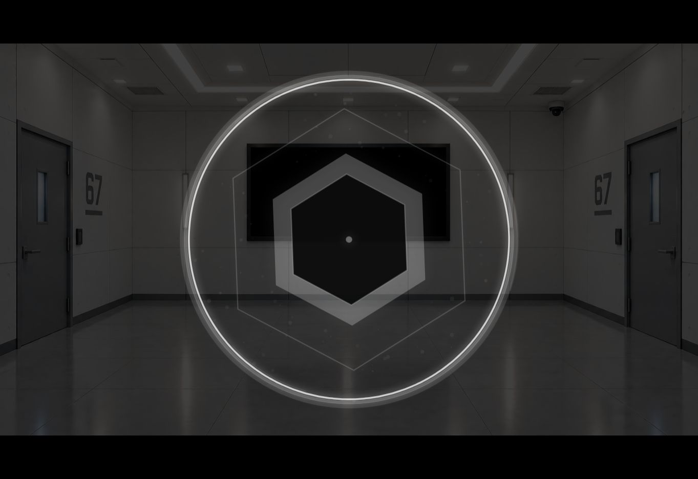
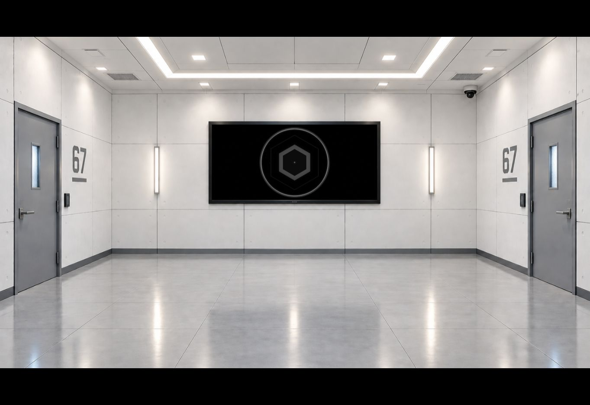
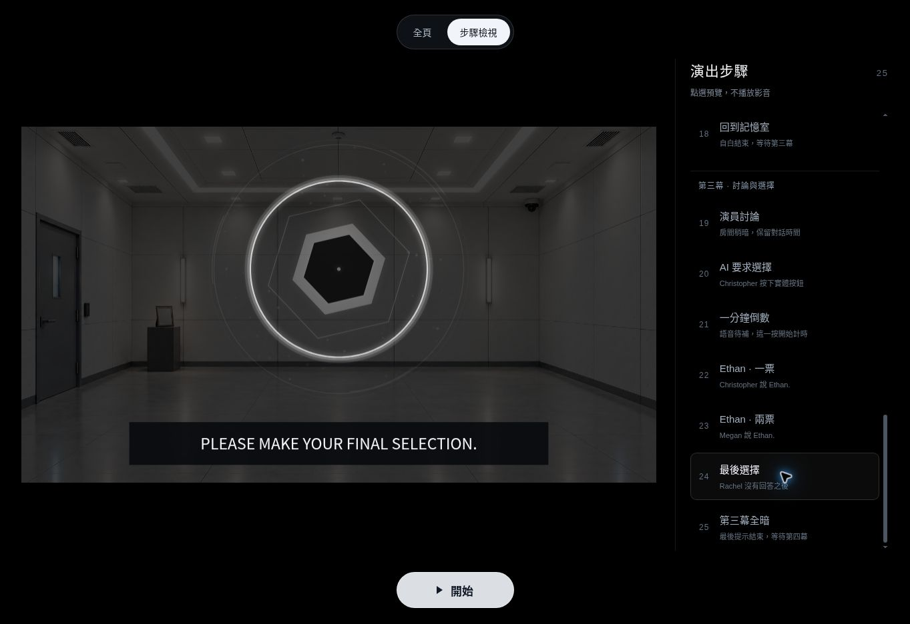
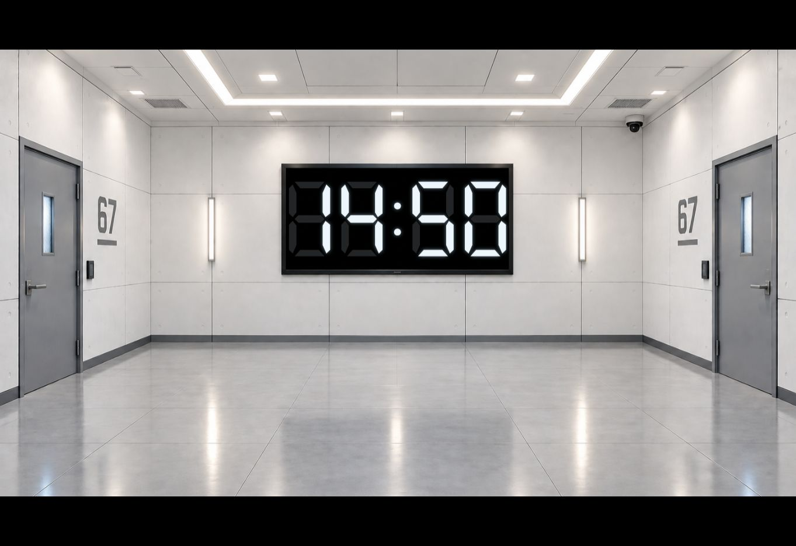
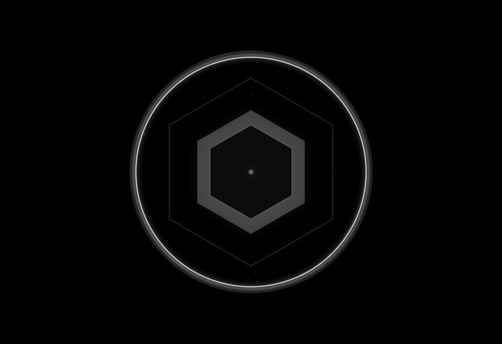
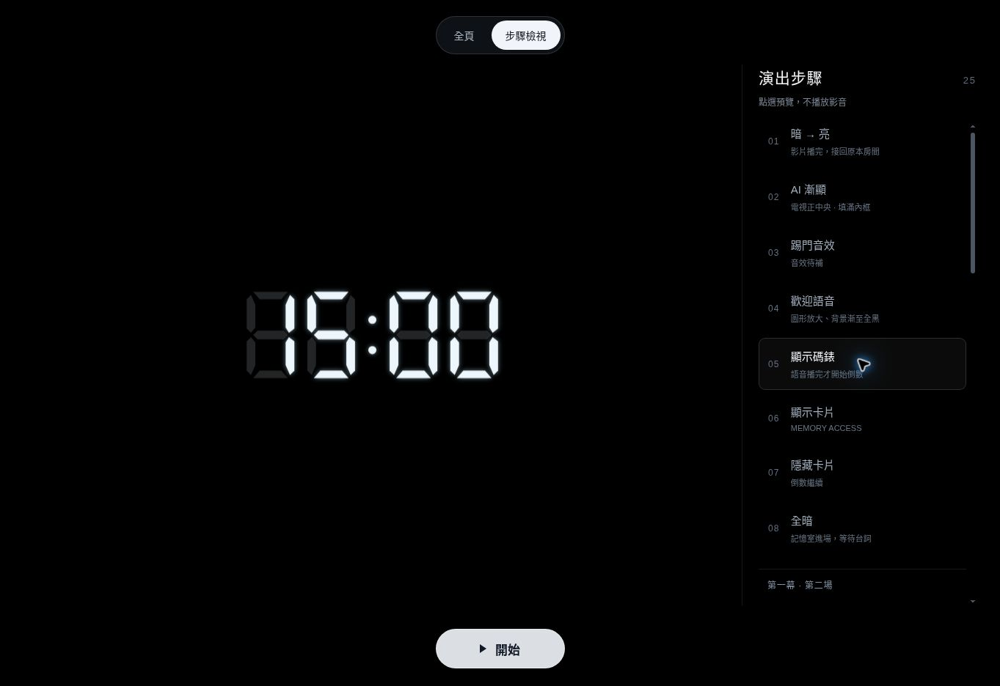
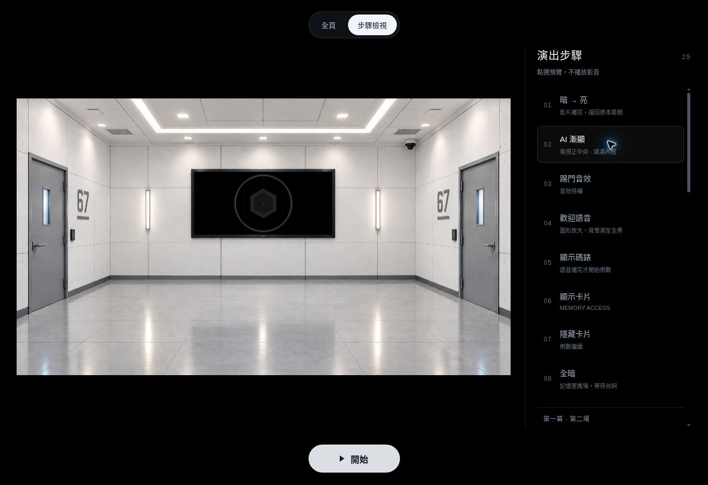
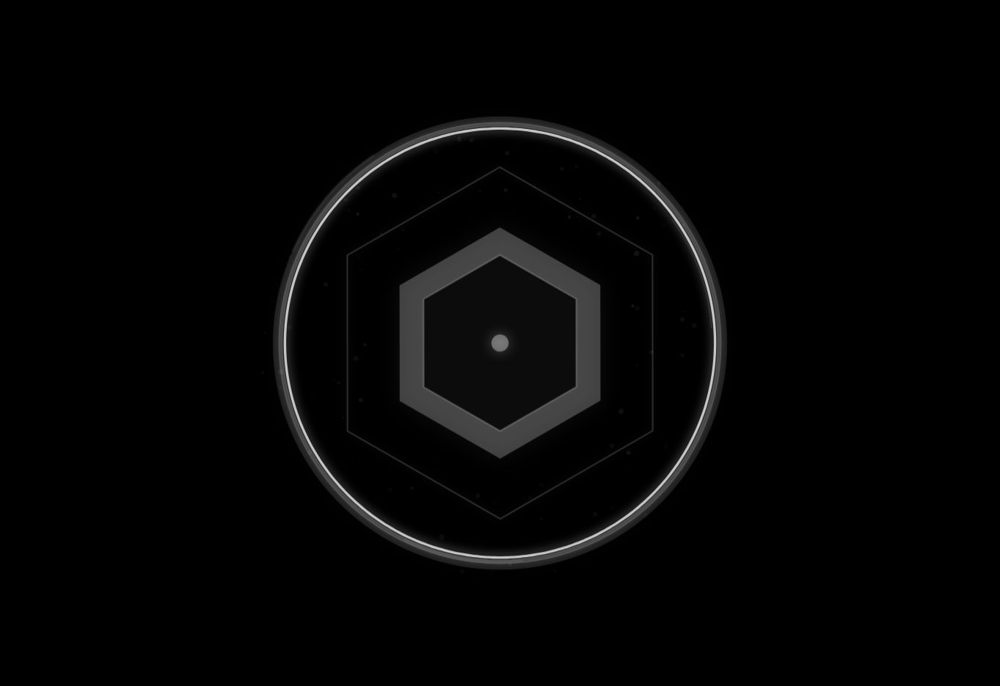
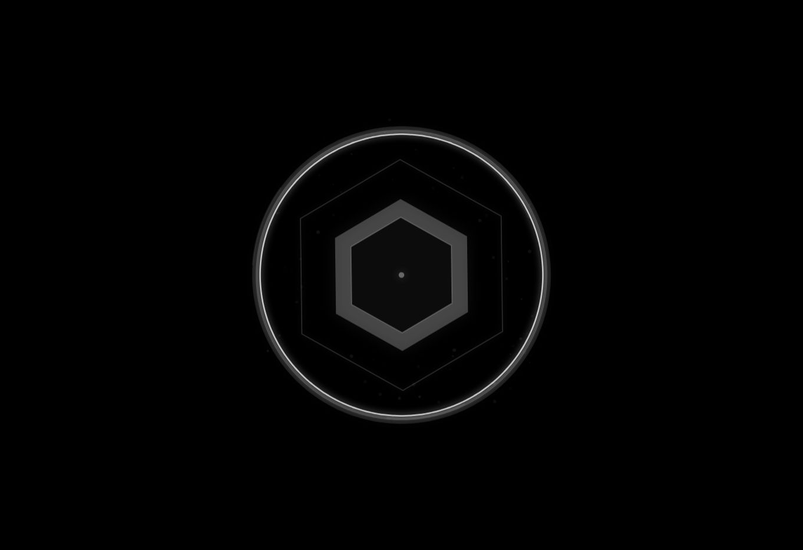

# AI 圖形放大

開場、記憶室歡迎與第三幕四段 AI 配音共用相同效果：圖形等比例放大到畫面前方，
原背景保持構圖與 cover 裁切位置，逐漸暗至全黑。只有圖形、波形與粒子改變大小。
語音真正結束後圖形縮回、恢復原房間亮度，原有 cue 與碼錶期限不變。

開場待機圖形對準 `IMG_0165.png` 的原電視內框中央；配音期間放大脫離這個內框。
記憶室與投票待機中心保留 X＝50%、Y＝40%。所有圖形維持比例，波形與發光留在畫框內。
整組圖形的縮放比例、中心及外圈不隨音量改變；內部六邊形恢復音量變形、邊線粗細與核心反應。
波形恢復原本的平方音量、對稱頻譜及向外起伏；超出範圍時，只等比例縮放該層波形，保留曲線形狀。
放大圖形改為前版的約 82%；電視待機尺寸、碼錶與背景構圖保持原樣。

| 時機 | 圖形 | 背景 |
| --- | --- | --- |
| 開場待機 | 原電視中央、內框可容納的最大尺寸 | 原亮度 |
| 開場語音 | 1600 ms 放大至畫面中央 | 構圖不動，漸暗至全黑 |
| 開場播完 | 1000 ms 縮回原位 | 恢復原亮度 |
| 記憶室／投票語音 | 900 ms 放大 | 構圖不動，漸暗至全黑 |
| 記憶室／投票播完 | 600 ms 縮回 | 記憶室恢復原亮度，投票恢復 80% |

投票圖形保留 Y＝40% 的中心，圖形與光暈不超過畫框高度 78%；字幕從 Y＝83% 開始。
開場碼錶縮回原背景電視的正中央，依內框放到最大、數字與光暈不越框。
無電視的投票場景維持原有碼錶 Y＝40%、大小＝37%。錄音尚未提供的正式 cue 保留待機圖形；
開始前的步驟檢視可靜音預覽放大狀態。

`roomScreen` 僅用於開場待機定位：原圖 1536 × 1024，內框 x＝552、y＝310、
寬＝430、高＝195、內距 2 像素。`voiceDim` 控制播放中背景的暗化程度。

## 前版實際預覽（2026-10-12）

以版本 `ea7847e` 在 HTTPS 預覽按開始及 Space，自然播放原影片與 29 秒 M4A。
語音播放中圖形放大，原房間構圖保持不動、降低亮度；所有控制按鍵已隱藏。
語音自然播完後，圖形縮回原位、背景恢復亮度，仍停在歡迎 cue 等待新按鍵。

記憶室與四段投票配音的錄音尚未提供，下圖為開始前靜音預覽。
所有影音時間都是 0；圖形與投票字幕保留空隙。

## 前版完整驗證

版本 `ea7847ef1ece4ae445145ff4777c3eac22f6dfb6` 的
[79 項控制／版面測試及 18 組 Chrome 實播檢查](https://github.com/mymcworld3-droid/Ai-shape/actions/runs/38189682656)
全部通過。以原照片獨立像素比對確認背景構圖不變、播放中亮度為 25%；
放大範圍由 AI 像素本身量測，畫面兩側符合原背景且沒有額外黑框或電視邊框。

涵蓋開場原始 MP4 與完整 M4A 自然播放、記憶室及四段投票的真實 PCM 播放、
音訊分析、真實結束後縮回、獨立重試、三種螢幕比例及最大頻譜。
25 個 cue、開始閘門、隱藏控制、兩個獨立期限、碼錶位置、卡片及精確全暗檢查也全部保留。
正式未提供的錄音仍維持 `null`，不以 PCM 測試音代替。

## 開場碼錶定位

縮小後的開場碼錶與 AI 共用原圖的 `roomScreen` 內框位置。
七段數字以 236 × 84 的座標範圍等比例縮放，放到內框能容納的最大尺寸；
原圖 2 像素內距隨背景縮放，數字與光暈都限制在這個內框。
播放中碼錶仍在畫面前方，真正語音結束後在 1000 ms 內縮回電視中央。
十五分鐘仍只由原始音訊的真正 `ended` 啟動，調整位置不重設期限。

## 最新碼錶與全黑背景驗證（2026-10-12）

版本 `252d0a719d23f19feac5cecbc4da9352b150636b` 的
[82 項控制／版面測試及 18 組 Chrome 檢查](https://github.com/mymcworld3-droid/Ai-shape/actions/runs/38190776743)
全部通過。三種比例均以原背景獨立像素比對，確認縮小後碼錶置於電視正中央、
佔內框寬度超過 95%，全部數字及光暈不越過內框。
放大後圖形仍可見，兩側背景與投票字幕間隙的 RGB 像素精確為零。
十五分鐘與投票一分鐘的期限、25 個 cue、音訊結束及重試流程均保持正常。

HTTPS 預覽另外自然播放原開場影片與完整 29 秒 M4A。
語音播放中截下放大圖形與全黑背景；語音自然結束後，碼錶已在原電視內框中央，
顯示持續計時的 14:50，控制按鍵保持隱藏。

下圖為開始前的放大碼錶靜音步驟預覽，所有影音時間為 0，未啟動倒數。

## 第二步漸顯

第二步的 AI 以 1500 ms 從完全透明平順淡入；位置與尺寸仍對準原電視內框。
步驟檢視也會播放相同的淡入，重點同一步可重播。背景未載入時，先保持透明，
等圖片能繪製後才開始計算淡入時間。切換其他步驟會取消這段預覽，按開始仍回到第 1 步。
預覽不播放影音或啟動倒數；正式演出在漸顯完成前仍鎖住下一個 cue。

## 第二步漸顯驗證（2026-10-12）

版本 `f964a000de4c8657b2088fa90386fd95b81f05f8` 的
[84 項控制／版面測試及 19 組 Chrome 檢查](https://github.com/mymcworld3-droid/Ai-shape/actions/runs/38192886226)
全部通過。新增獨立 Canvas 像素量測，驗證預覽及正式播放均有透明、中間濃度、完全顯示的連續過程。
另外測試背景延遲載入、同一步重播、切換其他步驟取消，以及漸顯途中按開始回到第 1 步。
預覽影音時間維持 0、兩個倒數期限保持未啟動；原本碼錶定位、全黑背景與 25 個 cue 檢查也保留。

HTTPS 預覽另外點選第 2 步，連續拍下剛開始、漸顯中、完全顯示的畫面。
所有影音皆暫停且時間為 0。

| 剛開始 | 漸顯中 | 完成 |
| --- | --- | --- |
|  |  |  |

## 音量與尺寸分離驗證（2026-10-12）

版本 `0a1af7ba675da1226cd8d3ebb605132d5045c552` 新增瀏覽器回歸檢查：
在 1920 × 1080、1440 × 900、390 × 844 三種比例，逐一檢查開場待機、開場歡迎、
記憶室歡迎與投票提示，頻譜依序為 0、96、255、0。
每次繪製的中心、縮放比例、外框半徑與兩道圓環半徑完全相同，內部波形仍隨音訊改變。
最大頻譜的像素範圍、字幕空隙與電視內框限制另由既有獨立 Canvas 檢查確認。

HTTPS 預覽另外自然播放原始 29 秒 M4A，截下語音播放中與真正播完後縮回電視的畫面如下。

| 語音播放中 | 語音播完縮回 |
| --- | --- |
|  |  |

[84 項控制／版面測試與 20 組 Chrome 檢查](https://github.com/mymcworld3-droid/Ai-shape/actions/runs/38194259010)全部通過。

## 縮小前景並恢復內部音訊反應（2026-10-12）

版本 `605ccb5133481f17f9bc312ea4edf7f10e828c4d`：
- 前景框以原中心縮小至 82%，同一劇情步驟下相機縮放比例不隨頻譜變化。
- 六邊形恢復頻譜頂點變形、音量帶動的半徑、原本邊線增厚與核心大小，外六邊形也恢復低音變形。
- 四層波形使用原平方音量、振幅、頻段對稱及向外起伏；超出範圍時只縮放該層波形，完整保留曲線形狀。
- 外框及圓形範圍雙重限制所有筆畫／光暈，不以當前音量重新縮放整組圖形。

瀏覽器回歸檢查直接擷取繪製的六邊形路徑、描邊寬度及波形點，驗證安靜到最大頻譜時
內部圖形確實改變，但中心、相機比例、外圈與固定半徑完全一致；
前景實際縮放比例約為前版 0.82 倍，開場待機位置及大小相同。
檢查涵蓋開場待機／歡迎、記憶室歡迎、投票提示及三種螢幕比例。

HTTPS 預覽自然播放原始 29 秒 M4A：播放約 11.9 秒時，前景 AI 較前版縮小且背景全黑；
真正 `ended` 後恢復房間，圖形自動縮回。開始後控制按鈕保持隱藏。

縮小前景與恢復聲音反應（`605ccb5`）：[84 項控制／版面測試與 20 組 Chrome 檢查](https://github.com/mymcworld3-droid/Ai-shape/actions/runs/38195567086)全部通過。
