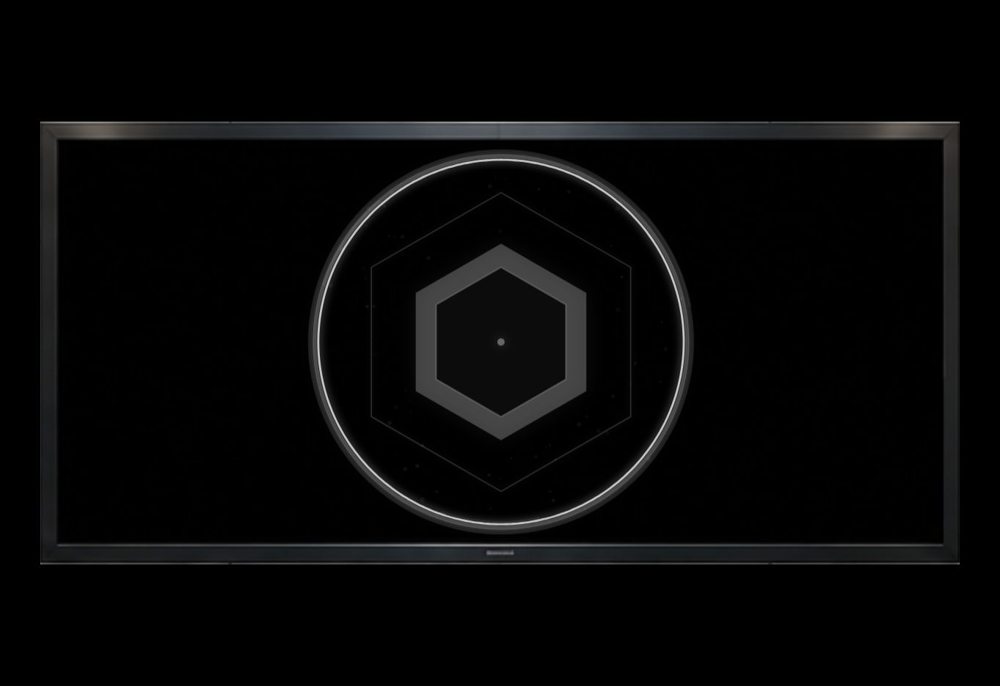
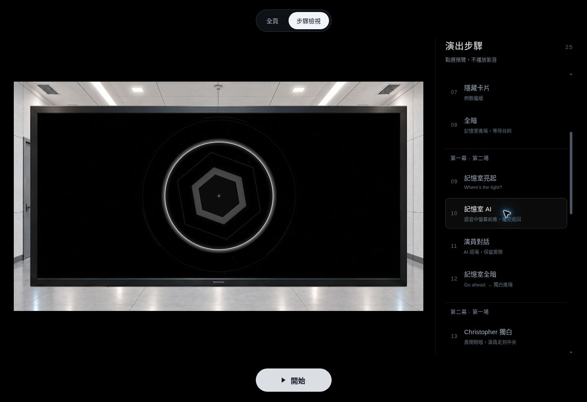

# AI 螢幕前推放大

所有 AI 配音開始真正播放時，整台電視連同黑色螢幕、圖形、波形及發光
一起向鏡頭靠近。開場、記憶室歡迎及第三幕四段配音共用相同效果。
語音真正結束後自動退回；原有 cue、碼錶期限與按鍵順序不變。
開始前的步驟檢視可靜音預覽每段的前景螢幕。

待機時，開場圖形仍在原背景電視正中央，填滿黑色內框；記憶室及投票
待機中心保留 X＝50%、Y＝40%。配音期間改以移動後的螢幕作定位，
而不是把放大圖形繼續限制在背景那個小電視的位置。

`opening-config.js` 量取同一張 `IMG_0165.png` 的原圖像素：

| 區域 | 左上角 | 尺寸 |
| --- | --- | --- |
| 原圖 | x＝0、y＝0 | 1536 × 1024 |
| `roomDisplay` 完整電視邊框 | x＝543、y＝300 | 447 × 216 |
| `roomScreen` 黑色內框 | x＝552、y＝310 | 430 × 195 |

直接取用原圖中的電視邊框，不需新增背景或素材。電視維持原比例，
前推至寬度上限 92%、高度上限 90%，圖形在移動內框中保持最大等比例尺寸。
所有波形、粒子與發光都限制在這個移動內框，不能越過它的邊框。
投票畫面將整台電視高度限制在 76%、中心 Y＝40%，底緣不超過 78%；
字幕從 Y＝83% 開始，保留空隙。碼錶縮回後仍為 Y＝40%、大小＝37%。

開場前推時間 1600 ms、退回 1000 ms。記憶室及投票前推 900 ms、
退回 600 ms，均由實際音訊事件控制；錄音未提供的正式 cue 保留待機圖形。

## 新版完整驗證（2026-10-12）

版本 `9e6e916ce34cb7eb0ce29f5b71992e7e6a5051a3`：
[Chrome 與控制流程執行](https://github.com/mymcworld3-droid/Ai-shape/actions/runs/38188418789)
全部通過，79 項單元／控制／版面測試、18 組 Chrome 154 瀏覽器檢查。

- 開場實播原始 MP4 與完整 29 秒 M4A，真正結束後啟動十五分鐘並退回原位。
- 以獨立像素比對扣除電視照片，確認放大的確是 AI，並非只畫一塊大黑框。
  前景螢幕尺寸超過原電視三倍，AI 像素高度超過原內框 2.5 倍。
- 記憶室與四段投票配音均以測試服務限定 PCM 真實播放，確認音訊分析、
  前推幅度、真正結束後退回、獨立重試以及兩個期限不變。
- 1920×1080、1440×900、390×844，最大頻譜輸入的波形、粒子與光暈
  均留在移動內框；字幕空隙仍精確符合背景，圖形不遮住投票文字。
- 保留 25 個 cue、開始前靜音預覽、開始後隱藏控制、長按不排隊、
  碼錶 Y＝40%／大小＝37%、卡片與精確全暗等完整既有檢查。

## 新版實際預覽

2026-10-12，以版本 `9e6e916` 在 HTTPS 預覽操作開始鍵與同一個 Space 鍵。
原始開場影片自然播完；`ai-opening.m4a` 在語音播放中 8 秒時拍下前推效果，
完整 29 秒自然結束後拍下退回畫面。兩張實播畫面均無控制按鍵，
語音結束仍停在歡迎 cue，沒有代操作員跳到下一步。

記憶室與四段投票語音的錄音尚未提供，下圖為開始前的靜音步驟預覽。
確認所有影音均暫停且時間為 0；投票螢幕與字幕之間留有空隙。

## 前版固定電視定位驗證

2026-10-11，執行版本 `a9310193dc906a8ed78c85dc799a58ae90f72a6e`：

- 53 項單元、控制及版面測試通過。
- [Chrome 完整演出測試](https://github.com/mymcworld3-droid/Ai-shape/actions/runs/38139145787)
  通過，包含完整影片、完整語音、碼錶、卡片與記憶室。
- 以原背景獨立像素比對：AI 靜態居中且接近內框上下緣；真實語音與
  最大頻譜輸入下，波形、外圈、粒子及發光都未超出電視。
- 1920×1080、1440×900、390×844，全頁與步驟檢視皆涵蓋。
- HTTPS 預覽另確認開始前影音時間為 0；開始後影片自然結束，
  按鍵全部隱藏，AI 出現在電視中央。

