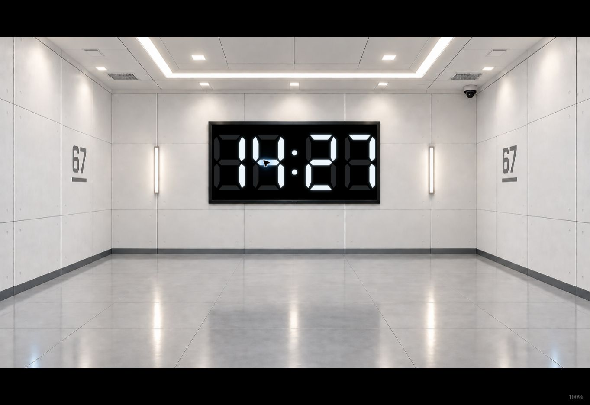
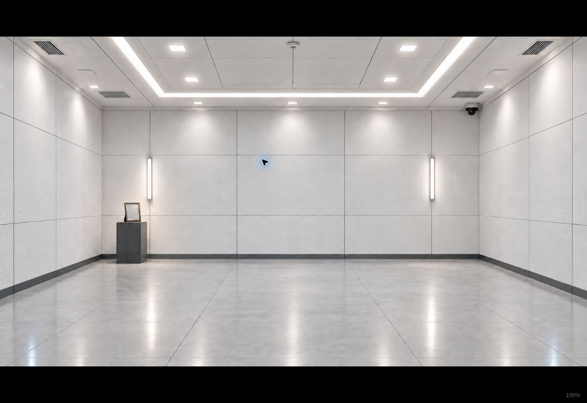

# 無門密室、無門記憶室與碼錶先於踢門

密室的左右兩扇門、暗圖中的兩扇門，以及記憶室左門皆已移除；門框、門把、窗、鉸鏈與門禁一併換為連續牆面。辦公室保留原樣。使用內建 imagegen 的 precise-object-edit 編輯原圖，不改變原本構圖、尺寸、亮度方向與電視定位，記憶室小台及相框保留。

| 執行素材 | 尺寸／格式 |
| --- | --- |
| assets/backgrounds/IMG_0165.png | 1536 × 1024 PNG，明亮無門密室 |
| assets/backgrounds/Start_dark.PNG | 1536 × 1024 PNG，暗藍無門密室 |
| assets/backgrounds/memory-room.png | 1672 × 941 PNG，明亮無門記憶室 |
| assets/videos/Start_animation.mp4 | 910 × 512、H.264、30 fps、128 幀、約 4.2667 秒、無聲 |

播放序列由第 3 步歡迎語音、第 4 步碼錶、第 5 步踢門、第 6 步卡片組成。語音真正結束後照原期限倒數；碼錶在踢門前顯示，踢門播放／重試時保持顯示。碼錶、踢門、卡片與返回操作都不重設倒數。步驟檢視與鍵盤前進／返回同步使用這個順序。

## 亮密室的編輯 prompt

```text
Use case: precise-object-edit. Edit target: the supplied bright test room background for a theater projection. Remove BOTH the left door and the right door COMPLETELY: door slabs, windows, handles, hinges, door frames, thresholds and adjacent small black access controls. Replace their entire areas with continuous solid light-gray wall panels matching the wall material, perspective, panel seams and baseboards. Keep the existing 67 wall numbers. Preserve the ORIGINAL camera, framing, aspect ratio 3:2 and room architecture. Especially preserve the black TV screen and bezel EXACTLY at the same location and dimensions: original image is 1536x1024, black screen interior approx x552,y310,width430,height195. Keep TV black and empty. Keep the wall lights, ceiling lights, security camera, vents, reflections, floor and bright even neutral-white lighting unchanged. No doors, no door-shaped outlines or recesses, no extra windows, no new objects, no people, no AI graphics, no timer. Output ONE finished image, same framing as reference.
```

## 記憶室的編輯 prompt

```text
Use case: precise-object-edit. Edit target: the supplied bright Memory Room theater background. Remove the LEFT door completely including window, handle, hinges, doorframe, threshold and adjacent small black access control. Replace with a continuous plain light-gray solid wall, with perspective-correct panel seams and dark baseboard matching surrounding walls. There must be ZERO doors and ZERO door-shaped frames, recesses or outlines anywhere. Keep everything else unchanged: ORIGINAL wide 16:9 framing and camera, room geometry, bright even neutral-white lighting, ceiling, wall lights, security camera, floor reflections, and especially the LEFT upstage dark pedestal and upright empty picture frame. Preserve the blank rear wall, no TV, no people or new objects. Output ONE finished background, same framing as reference.
```

## 初始暗密室的移門 prompt（初稿）

```text
Use case: precise-object-edit. Edit target: the supplied dark blue test room opening background. Remove BOTH doors on the LEFT and RIGHT, including windows, handles, hinges, frames, thresholds and adjacent small access controls. Replace each with continuous matching solid wall panels and baseboard, in the same dark blue lighting. Keep the 67 wall numbers. ZERO door outlines, recesses, openings or windows. Keep ORIGINAL camera, framing, room architecture and aspect ratio 3:2. Preserve the central empty black TV with bezel at exactly the same location and dimensions, ceiling, security cameras, vents, wall lamps and dark blue floor reflections. Preserve the existing dark nighttime blue atmosphere and brightness. Change only door areas and access controls; do not brighten the room, move the TV or introduce new objects, people, AI or timer. Output ONE finished image, same framing as reference.
```

## 暗亮幾何對齊的最終暗圖 prompt

最終暗圖改以無門亮圖作為幾何基準、第一版無門暗圖只作為照明參考，減少漸亮轉場中電視與牆面的重影。

```text
Use case: lighting-weather. Image 1 is the EDIT TARGET: the bright doorless test room. Image 2 is ONLY a dark-blue LIGHTING AND COLOR reference, NOT geometry. Make Image 1 into its dark blue nighttime opening state. STRICT: retain Image 1 pixel-aligned geometry and framing, 1536x1024 landscape 3:2. Preserve exactly the camera, perspective, wall panel seams, floor tile edges, all light fixtures, ceiling edges, the two 67 wall numbers and especially the TV black interior approx x552,y310,width430,height195 and bezel at identical positions/sizes. Do not move any edges or objects at all: this will cross-dissolve directly into Image 1 and any positional change causes unwanted double images. Change ONLY illumination/color: dark navy walls/floor, cool blue ceiling strips and wall lamps, dim ceiling spots, restrained blue reflections, black empty TV. Same brightness and atmosphere as Image 2, but absolutely no copying its slightly different geometry. Both walls remain solid with ZERO doors, openings, windows, doorframes, handles or access controls. Do not add objects or glow around the TV that changes its shape. Output one finished image matching Image 1's exact framing and geometry.
```

## 開場影片

由新暗圖、亮圖各自以 cover 等比例裁切至 910 × 512；前 0.4 秒維持暗圖，中間約 3.4667 秒交叉漸亮，最後維持亮圖。編碼為 H.264／yuv420p 並設定 faststart，播放完接回同一張無門亮圖，不依賴外站。舊的大小寫不同、未被設定引用的 Start_animation.MP4 不參與播放。

## HTTPS 實播驗證

以 F 開始，新的無門 H.264 影片自然播放至 ended，瀏覽器回報長度 4.266667 秒且無解碼錯誤。
原始歡迎錄音自然播放至 29 秒結束，下一次右鍵先進入 clock；此時踢門播放器仍 paused=true、currentTime=0。
再按右鍵才播放原始 0.510204 秒踢門 WAV，碼錶保持可見。音效真正結束後，卡片顯示、隱藏、全暗與記憶室亮起皆依新按鍵推進。




## 自動檢查

執行版本 d47057bfacaae9ff4c0b40f3956981ca5a176c61：91 項控制與版面測試、24 組 Chrome 回歸檢查均通過。
分支與 PR 的完整檢查皆成功：
- https://github.com/mymcworld3-droid/Ai-shape/actions/runs/40824794942
- https://github.com/mymcworld3-droid/Ai-shape/actions/runs/40824798231

包含原始錄音自然播放、碼錶先於踢門、音效期間碼錶持續顯示、音訊失敗重試、鍵盤前進返回、0–100% 音量、兩個期限不重設、三種螢幕比例及所有既有場景與圖形效果。最後紀錄提交只補充本文件與實播截圖，不改動已驗證的程式、測試與執行素材。
