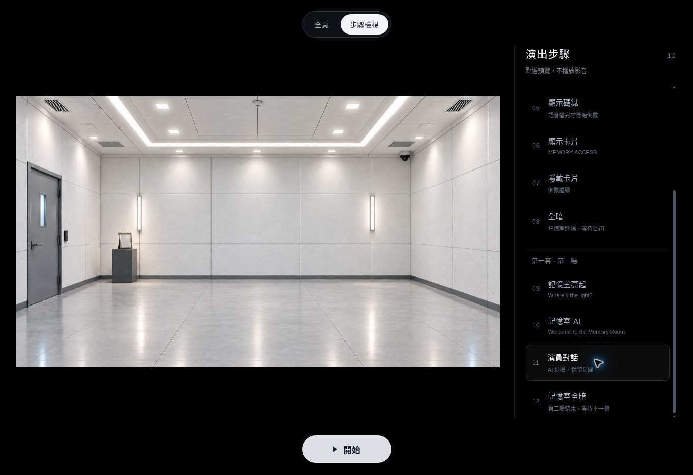
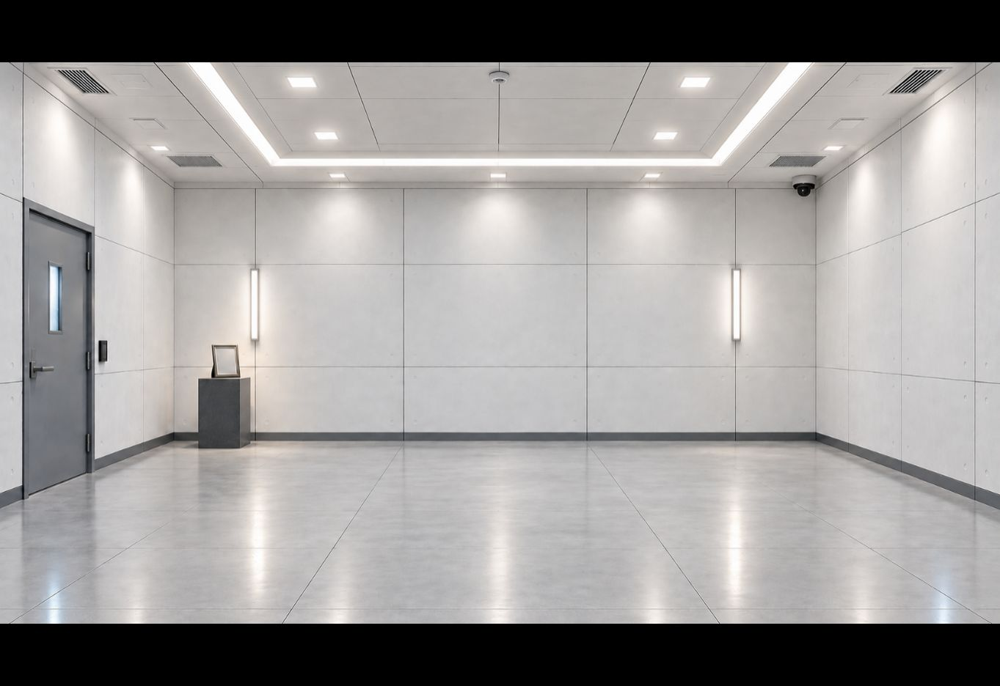

# 第一幕第二場：記憶室

沿用 `feat/one-key-opening`、16:9 畫框、背景 cover 裁切與同一個 Space 鍵。
開始後所有控制按鍵仍隱藏。第一場第 8 段全暗可一直停留，讓演員進場，
不會自動亮起記憶室。

| 段 | 按鍵時機 | 投影 |
| --- | --- | --- |
| 09 | Megan 說完 Where's the light? | 1 秒淡入記憶室，清除第一場的 AI、碼錶與卡片。開燈音效欄位預留。 |
| 10 | Rachel 說完 Scary. | AI 漸顯，配置後播放 Welcome to the Memory Room. |
| 11 | 歡迎之後，演員開始找相框 | AI 淡出，只保留房間。演員可自行掌握對話長度。 |
| 12 | Ethan 說完 Go ahead. 且準備轉幕 | 1.2 秒淡至全暗，停留等下一幕。 |

若提供記憶室歡迎語音，AI 圖形在 900 ms 內放大，原記憶室保持構圖並漸暗至全黑，
播完在 600 ms 內縮回並淡出，背景恢復亮度。圖形、波形與發光均限制在畫框內。
AI 會在真實 `ended` 後自動淡出，
第 11 段的操作仍保留，不會因此直接跳到全暗。影音播放中、動畫中、
長按和雙擊都不會排隊推進。播放失敗時，下一個新按鍵只重試該項影音。

原本十五分鐘期限會繼續，但第二場不顯示碼錶。
記憶室歡迎語音使用獨立播放器，不會重新啟動十五分鐘，或重播第一場語音。

## 需要補的素材

| 素材 | 建議檔案／內容 |
| --- | --- |
| 記憶室歡迎語音 | `assets/audio/ai-memory-room.mp3`；Welcome to the Memory Room. |
| 開燈音效 | `assets/audio/memory-light-click.mp3`；短、獨立的 click，避免長前置靜音。 |
| 相框道具照片 | Christopher 與 Liam 的合照；實際演員或你指定的角色照片，不在這次背景中生成長相。 |
| 相框背面 | To remember, to forgive, to forget. —Chris |

語音與音效備妥後，在 `opening-config.js` 的 `memory` 中設定：

```js
narration: "assets/audio/ai-memory-room.mp3",
lightClick: "assets/audio/memory-light-click.mp3",
```

目前兩個欄位都是 `null`，不會請求不存在的檔案。
歡迎 cue 先顯示 AI，第 11 段由操作員按鍵使 AI 退場。
相框與人物照片在劇本中是演員拿取的道具，不額外加上照片投影 cue。

## 背景

已用內建生圖工具，以原本 `IMG_0165.png` 為參考，製作
`assets/backgrounds/memory-room.png`。照明與原本亮房間一致，使用明亮白光、
淺灰牆面與清楚可辨的地板；只保留左側一扇門，右側是完整牆面。
左後方仍是一座小台與空相框。實際使用時等比例填滿 16:9，超出置中裁切。

最終使用的提示詞：

```text
Use case: lighting-weather and precise-object-edit. Edit Image 1, the Memory Room stage projection background. Image 2 is a lighting reference only, the original brightly lit room. Make Image 1 just as bright and evenly illuminated as Image 2: high overall room exposure, neutral white daylight-like overhead lighting, light-gray walls and a clearly visible light-gray floor, no dim blue mood and no dark vignette. Match Image 2's brightness in the whole room, not only its light fixtures. There must be exactly ONE door: KEEP THE LEFT WALL DOOR, and REMOVE THE RIGHT WALL DOOR completely including its window, handle, access panel and frame; replace that right door area with continuous plain light-gray wall panels matching the adjacent right wall. Preserve Image 1's level front-facing camera, fixed wide perspective, composition, left upstage small stand and upright blank photo frame, restrained metal architecture, and generous empty center and foreground for live actors. Keep the photo frame empty, with no invented portrait. The back wall remains plain and empty with no giant screen. Use full 16:9 landscape framing, crisp photorealistic theater background. No people, robots, text, room numbers, logos, watermarks, extra doorways, extra doors, hallways or windows. Change only the lighting/exposure and the removal of the right door, preserving the other scene elements.
```

記憶室之後已接入第二幕；[辦公室回憶的操作時機與素材](office-memory.md)。

## 驗證紀錄

2026-10-11：版本 `6d5984d` 使用最新上傳的 `Start_animation.mp4`
（H.264／AAC、910×512、4.27 秒），實播至自然結束後回到原亮房間。
51 項單元與控制測試通過；[Chrome 完整測試](https://github.com/mymcworld3-droid/Ai-shape/actions/runs/38135684529)
通過，包含 12 個靜態預覽、三種畫面比例、長按／雙擊、影音失敗重試、
真實媒體結束事件及跨場後維持原倒數期限。

另以公開預覽完整操作 12 個步驟，確認開始後所有按鈕隱藏，
新影片與開場語音各播放一次，明亮背景只保留左門，AI 退場後可停留對話。
語音與音效尚未提供的記憶室欄位仍留空，未冒充已完成配音。




