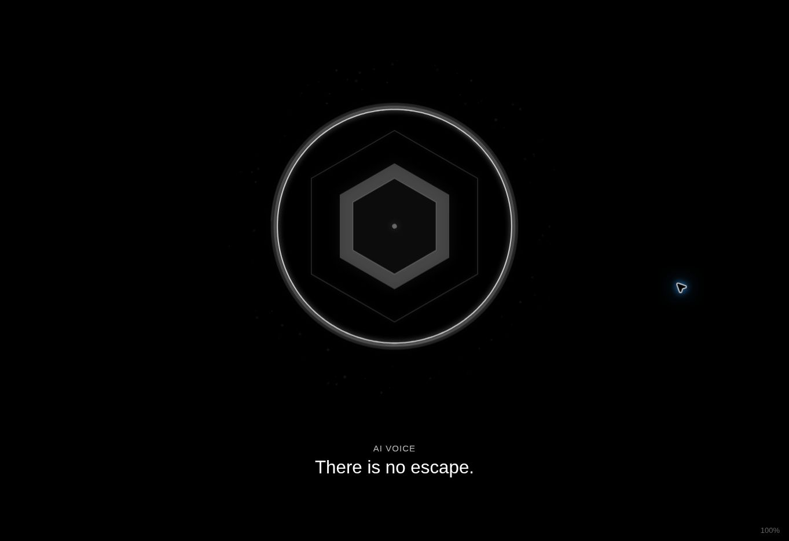
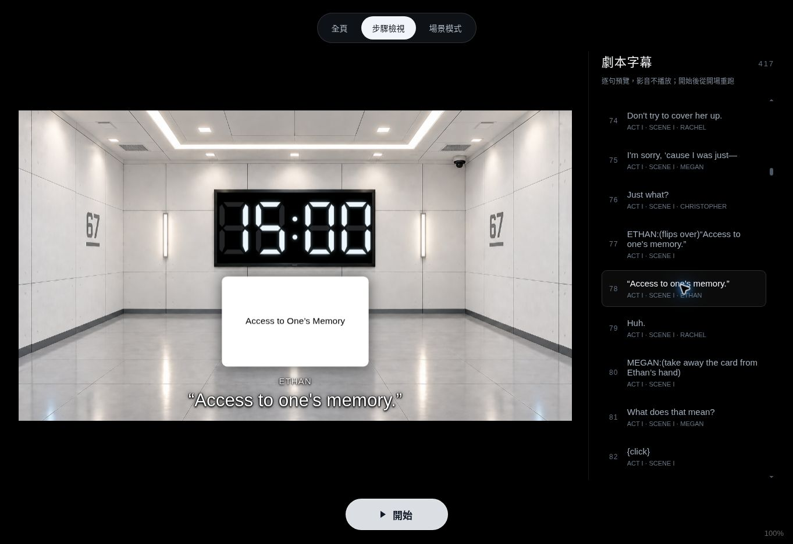
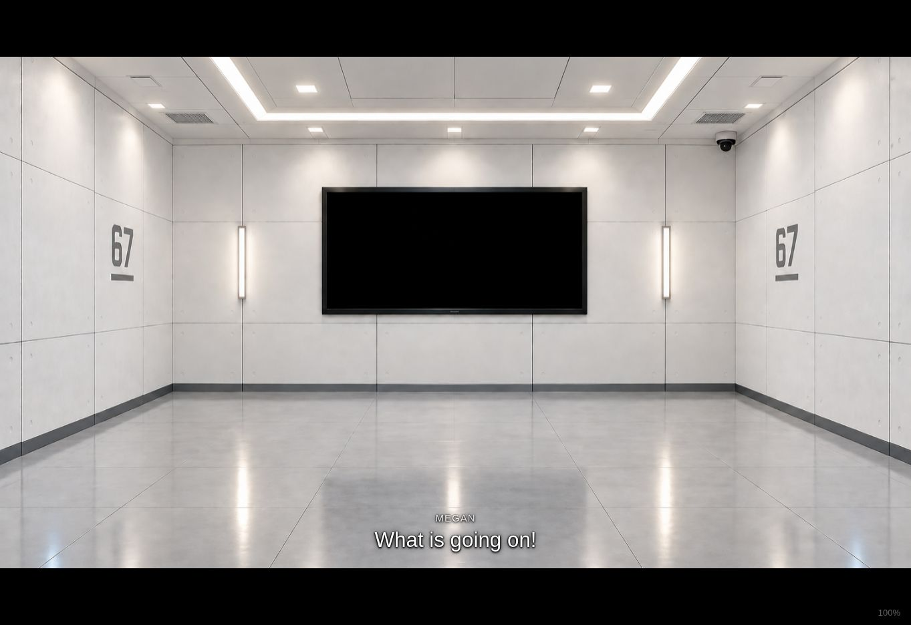

# 手動逐句字幕與劇本對照

預設為逐句字幕模式。按 F 或開始後，空白鍵、→、單擊／單次觸碰各前進一個步驟；← 回上一個步驟。1／Q 調整語音、2／W 調整背景音樂與音效，O 顯示／隱藏音量。開始後所有控制按鈕隱藏，字幕固定在 16:9 投影內下方。

依使用者上傳的 `Power playyyy.docx`，目前共 **374 句英文字幕、393 個手動步驟**，涵蓋四幕。第 385、386 段獨立步驟已合併到第 388 段首句提示語音，同次按鍵觸發。每句手動換，不以語音秒數或字幕長度自動跳句。純舞台動作不印成字幕；只有全暗、實際影音與必要畫面切換保留獨立步驟。純追光、停頓與演員出場不再占用操作步驟，原舞台指示仍保存在劇本來源內。

字幕除了刪除原稿第 64 段 Christopher 的 `It's empty.` 外，沿用原文，包括大小寫、用字與標點，未替劇本校正文法。角色名與動作分離；跨段續說繼承角色。第 88 段開門後的「AH!」在原稿沒有標明說話者，因此投影只顯示 AH!，不自行指定角色。卡片本身保留使用者指定的 `Access to One’s Memory`；Ethan 讀卡的字幕保留原稿 `“Access to one's memory.”`。

## 開場黑幕與無聲確認（2026-11-04）

預設逐句字幕模式在開始前完全純黑、無音訊。按下「開始」後，**步驟 1–2 都維持純黑且背景音樂不得播放**（角色台詞仍有字幕）；只在**步驟 3 的原稿第 23 段 [full] 房間亮起**時開始播放 `1-14.mp3`，之後依原配樂範圍切換。使用左鍵回到步驟 1–2 時也必須停止音樂，避免倒帶留下配樂；初始 25-cue 場景模式亦以純黑作為尚未開始的畫面。

## 操作與影音

- F 從開場開始；即使先預覽第四幕，也會回到第一個步驟。
- 歡迎語音首句啟動原 M4A，字幕可在播放中逐句前進。走到 `You have 15 minutes.` 時切成碼錶；語音期間維持 15:00，真正播完才開始倒數並縮回。
- AI 語音播完不會自動換字幕。到最後一句仍在播放時，前進按鍵忽略、不排隊；播完再按才進下一位演員台詞。
- ← 暫停影音並回上一句／動作；不重播音效，也不重設兩個倒數期限。仍留在同一段 AI 配音時，下一次前進會從暫停位置繼續；返回配音首句之前，再重新走入首句才從頭播放。字幕倒退不對錄音做逐句定位。
- 第三幕四段、第四幕兩段 AI 配音現已全部接入。若將來有缺檔，仍會保留可手動操作的字幕與錯誤提示；選擇提示的一分鐘從該段 AI 語音真正播完後開始。
- 第四幕接回記憶房間慢慢亮起；守衛進場和第 413 段沉默仍依劇本演出，但不必按額外一步。兩段 AI 配音已接入。最後一句 `You may leave.` 後，下一次操作立即切成純黑，不再插入沉默或重新亮起。
- 原本 25 步的場景操作模式可在開始前按「場景模式」切換，也可用 `?mode=cues` 開啟；該模式沒有逐句字幕。

## 背景與聲音對照

| 原稿段落 | 對應事件 |
| --- | --- |
| 23 | 房間從暗變亮，播放開場動畫 |
| 27–28 | AI 漸顯，歡迎語音與逐句字幕 |
| 33 | Megan 踢門，原 WAV 音效 |
| 42、53 | 開場背景稍暗／恢復明亮；實體追光由燈控執行 |
| 46 | timer clicks，已接短 click 音效 |
| 83、85 | Ethan 翻讀白卡／Megan 收回卡片，卡片顯示／隱藏 |
| 87 | 左門 click／開門聲，獨立於記憶室亮燈 |
| 99、109–110 | 進場全暗／記憶室亮起；第 110 段單獨播放 click |
| 115 | 記憶室歡迎語音，圖形放大、背景全黑，播完退場 |
| 185、188 | Christopher 獨白，稍暗房間／投影全暗 |
| 195、199、221 | 辦公室亮起／全亮／配合三追光稍暗，保留無桌背景 |
| 213 | 辦公室 BANG |
| 269、284、290 | 自白投影全暗／幕間全暗／回記憶室討論 |
| 385–388 | 第 366–368 步併成第 366 步：拍鈕音效、閃光、AI 選擇提示同時啟動 |
| 389–395 | Christopher 投 Ethan 一票；Megan 投 Ethan 第二票；各自 AI 確認 |
| 400–403 | Rachel? → 沒有回答 → 最後選擇提示 → 全暗 |
| 405–409 | 守衛進場 → 慢慢亮起 → Ethan 台詞 → 測試完成提示 |
| 413–416 | 演員依劇本沉默（不佔一步） → AI 揭露 → `You may leave.` → 直接純黑 |

## 音效位置與對應檔名

| 音效 | 專案檔案 | 設定欄位 | 劇本位置 |
| --- | --- | --- | --- |
| 時鐘 click | `assets/audio/effects/timer-click.wav` | `scriptEffects.timerClick` | 第 46 段 `{timer clicks}` |
| 沉重自動門開啟聲 | `assets/audio/effects/heavy-auto-door.mp3` | `scriptEffects.doorOpen` | 第 87 段 `{click}` |
| 記憶室 click | `assets/audio/effects/light-click.wav` | `memory.lightClick` | 第 110 段 `{click sound}`，獨立空白 cue |
| 辦公室 BANG（沿用踢門聲） | `assets/audio/door-kick.wav` | `office.bang` | 第 213 段 Ben 進場前 |
| 按鈕拍擊（已接入） | `assets/audio/Slam-button.m4a` | `scriptEffects.selectionButton` | 第 385–388 段，合併觸發 |

時鐘、記憶室短 click 是新增的 0.18 秒提示音。第 87 段開門聲使用使用者新上傳的 `heavy-auto-door.mp3`，取代原先的 `heavy-auto-door.wav`。第 213 段辦公室 BANG 則直接引用原本的 `assets/audio/door-kick.wav`，不另用替代檔；兩個播放元素仍各自獨立控制。

第一幕配樂檔名配合台詞編號更新為 `1-14.mp3`、`15-91.mp3`、`91-92(轉場).mp3`、`92-174.mp3`、`174-175(轉場).mp3`。舊的 `.mp3_` 副檔名已修正。所有原音檔只重新命名，不轉碼。

## 已接入的六段 AI 配音（2026-11-05）

| 上傳音檔（位於 `assets/audio/`） | 設定欄位 | 原稿 AI 台詞段落 |
| --- | --- | --- |
| `387-389ai.m4a` | `voting.prompt` | 第 388 段：請大家選擇機器人／剩餘一分鐘 |
| `391-392ai.m4a` | `voting.one` | 第 390 段：Subject Ethan. One vote. |
| `395-396ai.m4a` | `voting.two` | 第 395 段：Subject Ethan. Two votes. |
| `399ai.m4a` | `voting.final` | 第 402 段：Please make your final selection. |
| `404-406ai.m4a` | `ending.complete` | 第 409 段：測試完成，請前往出口 |
| `411-415ai.m4a` | `ending.revealTruth` | 第 414 段：沒有機器人、測試真相、You may leave. |

以上對應是依**音檔命名順序與劇本的六段 AI 語音出場順序**設定，原音訊未被重新剪輯、轉碼或語音辨識。第一幕 `ai-opening.m4a` 與記憶室 `Memory-room.m4a` 仍沿用原檔。

## 刪除無操作意義的步驟

原稿中的 `[middle spot light]` 與其他純追光燈光提示、`(silence)`/`(pause)` 以及「Two masked guards enter.」都不再生成獨立字幕操作步驟，總數由 416 減至 **393**，台詞仍為 **374 句**。影響投影亮度或場景的提示不會丟失：投影狀態沿用到**下一句實際字幕**。真正要手動觸發的開場影片、黑屏、音效、卡片和場景切換繼續保留操作點。

第一幕配樂依**原稿段落**（23、30、99、104、179、186）切換，不再按照被刪除後會重新編號的字幕步數。新的第三、四幕 AI 語音也一樣依對應劇本段落啟動，而非檔名數字剛好等於新的字幕步數。

## 核對方式

`docs/script-source.json` 保存 Word 的原始識別資訊、人工刪句紀錄，以及修訂後的段落；`tools/build-script.py` 由該來源產生 `script-data.js`。測試逐段還原所有台詞、檢查角色繼承、374 句順序、四幕背景邊界、兩票順序與終場。不是用舊版 PDF 或對話記憶生成字幕。

## 實際驗證畫面

最終執行版本 `13e4cd8` 的逐句字幕 Chrome 測試已通過：417 個步驟完整前進與倒退、374 句原稿字幕、三種畫面比例、實際 M4A 自然播完、單擊與空白鍵／方向鍵、音量及兩個倒數期限。
[執行記錄](https://github.com/mymcworld3-droid/Ai-shape/actions/runs/41561884582)。

另外在 HTTPS 預覽實際操作 F、空白鍵與左右鍵，確認開始後按鈕隱藏、暗轉亮影片自然播完、語音中字幕換句不重播音訊、語音結束不自動跳句。白卡縮至字幕模式的適合尺寸，避開上方電視碼錶與下方字幕；場景模式尺寸保持原樣。

最終版本另外讓 F／開始鍵直接要求全螢幕，並以 Chrome 測試檢查全螢幕元素為 `showShell`；瀏覽器若拒絕全螢幕，固定 16:9 畫框與字幕仍可正常操作。

## 字幕動畫

字幕出現時以 220 毫秒淡入並輕微上移；換句時舊句於 110 毫秒淡出，新句延遲 40 毫秒後用 180 毫秒淡入；隱藏時用 160 毫秒淡出。移動距離隨投影尺寸縮小，保持在 16:9 畫框內。

每次按鍵立即更新目前字幕與句子位置，動畫不阻擋操作或排隊。快速連按、左右來回、淡出中重新顯示，都會取消舊動畫，以最新一句為準；同一句的語音狀態更新不會讓字幕重新閃入。系統設定「減少動態效果」時直接切換。

動畫版本 `9d99e77`：99 項控制／原稿核對測試與 7 組 Chrome 字幕／動畫檢查通過，包含 374 句字幕、417 步完整前進倒退與三種比例。
[驗證執行記錄](https://github.com/mymcworld3-droid/Ai-shape/actions/runs/41564882871)。
另於 HTTPS 預覽以 F、空白鍵與左右鍵實際檢查切句、隱藏及快速返回後不殘留舊字幕。以下為動畫完成後的投影畫面。

中央追光 `[middle spot light]` 步驟只將背景調暗至 65% 亮度；圖形與碼錶保持電視內框的原位置和大小，放大只在 AI 語音步驟使用。

## 2026-11-04 調整紀錄

原稿第 64 段的 `It's empty.` 刪除後，為原稿第 110 段 `{click sound}` 新增獨立音效步驟。因此共有 374 句實際字幕及原先 417 個操作步驟。劇本原始檔案雜湊識別不變；修訂後內容在 `docs/script-source.json`，可由 `tools/build-script.py` 重建。

## 2026-11-04 結尾調整

第 415 段的獨立沉默步驟已移除。當操作員在 `You may leave.` 後按下一步，直接進入第 416 段最終全黑（立即切換、無淡出），AI 最後一段錄音結束也不會先讓記憶室重新變亮。現為 **374 句字幕、416 個步驟**。
