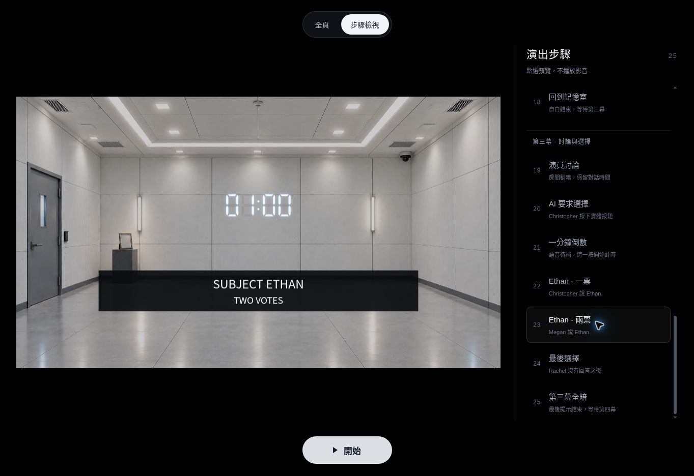
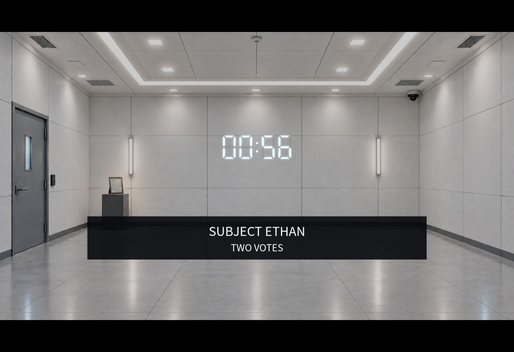
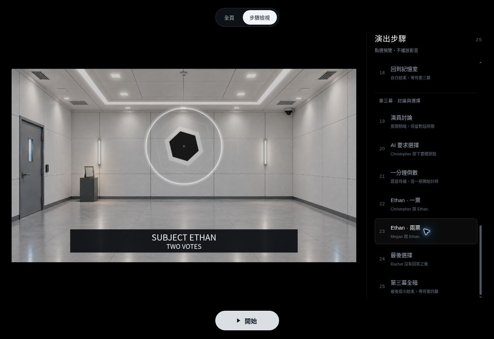
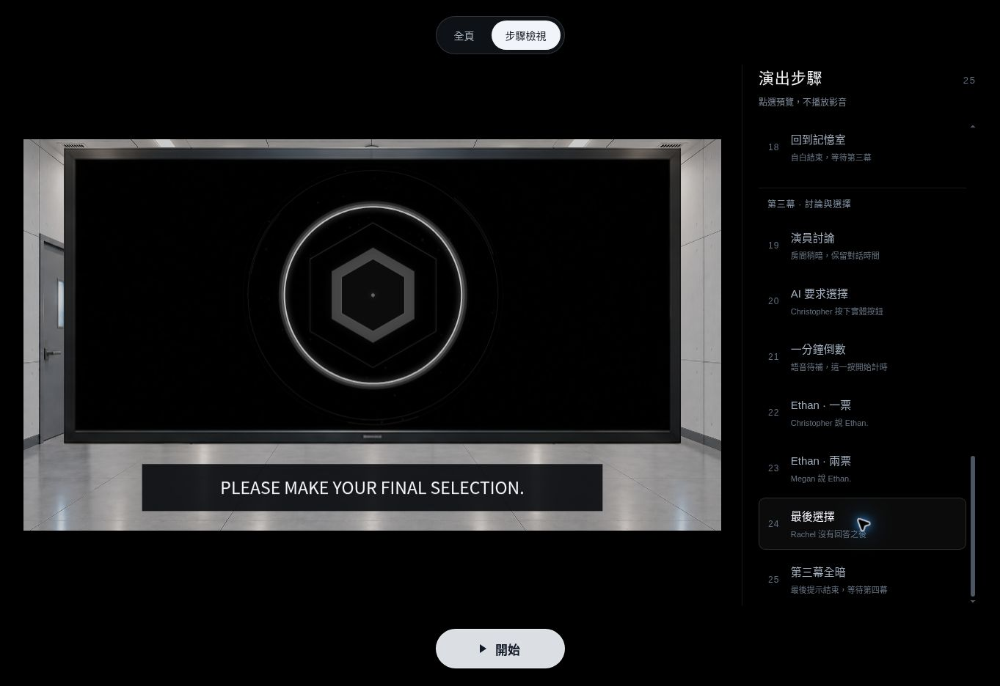

# 第三幕 — 討論與選擇

依劇本 `Power playyyy(1).pdf` 第 17–23 頁接入第三幕。
沿用明亮單門記憶室，討論時稍暗至 80% 亮度；不另換背景或添加影片。
共七個新步驟，全流程 25 個 cue，仍只使用 Space／單擊／觸碰。
開始後所有控制按鈕隱藏；開始前的步驟檢視只顯示靜態畫面，不播放或計時。

## 按鍵時機

| 步驟 | 按鍵時機 | 行為 |
| --- | --- | --- |
| 19 | 第二幕自白結束、回到記憶室後，第三幕演員就位 | 房間稍暗；保留所有演員討論，不設固定台詞秒數。 |
| 20 | Christopher 按下實體按鈕 | 顯示選擇提示，播放配置的選擇語音；目前語音未提供。 |
| 21 | 選擇提示結束，準備接受第一個名字 | 顯示獨立一分鐘碼錶。現階段由此按鍵開始；有語音時在提示真正播完啟動，這一按只顯示已開始的時間。 |
| 22 | Christopher 說 Ethan. 後 | 顯示 SUBJECT ETHAN / ONE VOTE，播放對應語音。 |
| 23 | Megan 說 Ethan. 後 | 顯示 SUBJECT ETHAN / TWO VOTES，播放對應語音。 |
| 24 | Ethan 說 Rachel?，Rachel 沒有回答，停頓後 | 顯示最後選擇提示，播放對應語音。 |
| 25 | 最後選擇提示結束，導演指定全暗時 | 1.2 秒淡至精確全暗，等待第四幕。 |

劇本在 Rachel 沒有回答後直接進最後提示；沒有添加第三票或票選結果。
每段配音開始真正播放後，整台電視與 AI 在 900 ms 內向鏡頭前推放大，
波形隨該段語音變化；圖形限制在移動後的內框，電視底緣不超過畫框 78%。
碼錶暫時讓位給圖形，期限仍持續計算；字幕放在下方，不遮住放大圖形。
選擇提示播完後，螢幕與 AI 在 600 ms 內退回待機位置，等待第 21 步顯示碼錶。
一票、兩票及最後選擇播完後，同樣自動縮小並恢復正在倒數的碼錶。
放大與縮小都不推進下一個 cue；每段配音各自等待真正的 `ended`，完成後仍須新按鍵。
播放失敗時下一按只重試該段；長按、雙擊或漸變期間的按鍵不排隊。

一分鐘是本幕獨立期限；原開場十五分鐘期限持續運作、不被覆寫。
碼錶維持 X＝50%、Y＝40%、大小＝37%，與稍暗背景分開計算尺寸。
歸零停在 00:00，不會自行投票、播放爆炸或提前黑場。
四段語音留 `null`，不以測試聲音假裝配音完成；沒有錄音時不假裝正在播放或放大。
開始前的步驟檢視可靜音查看四段語音播放時的放大圖形。
缺選擇語音時，
明確以第 21 步啟動一分鐘，不用假結束事件或預估語音秒數。

## 待補素材與精確台詞

| 建議檔名（放在 `assets/audio/`） | 設定欄位 | 完整台詞 |
| --- | --- | --- |
| `ai-selection.mp3` | `voting.prompt` | Please make your selection. One by one, state the name of the person you believe to be the robot. 1 minute remaining. |
| `ai-ethan-one-vote.mp3` | `voting.one` | Subject Ethan. One vote. |
| `ai-ethan-two-votes.mp3` | `voting.two` | Subject Ethan. Two votes. |
| `ai-final-selection.mp3` | `voting.final` | Please make your final selection. |

背景與碼錶已具備，不需新增圖片。實體按鈕沿用原劇道具。
本幕沒有新增劇本指定音效；先前踢門、記憶室 click、辦公室 BANG 仍待提供。
第四幕的測試揭露與終場尚未接入，第三幕全暗後不會自行顯示結局。

## 驗證

75 項控制與版面測試通過，包含 25 步跨幕、四段配音的獨立結束／重試、
真正提示結束才啟動一分鐘、缺提示語音時的手動計時、晚到錯誤、長按、
精確歸零與原期限不變。Chrome 測試保留全部先前檢查，另驗證投票文字
確實改變、三種比例的背景／碼錶位置、全暗像素及四段實際 PCM 配音測試。
正式錄音設定維持 `null`。

2026-10-11：版本 `90e266b` 的 73 項控制／版面測試與 17 組正式 Chrome
檢查全部通過，[完整執行](https://github.com/mymcworld3-droid/Ai-shape/actions/runs/38144886327)。
Chrome 154 使用完整影片與開場語音自然播放；新增四段錄音以測試服務
限定 PCM 檢驗真實結束、逐段重試、長按不排隊及兩個期限獨立。

另在 HTTPS 預覽由「開始」實際以 Space 跑完全部 25 個步驟，
4.27 秒影片、23.684 秒語音各自然播放一次。從兩票預覽開始仍回第一 cue；
演出期間沒有可見按鈕，辦公室、回到記憶室、兩票與最後全暗依序確認。
到第三幕全暗後再按 Space，保持全暗等待第四幕。

## AI 語音放大驗證（2026-10-12）

版本 `ab9aec1` 的 75 項控制／版面測試與 18 組 Chrome 檢查通過，
[完整執行](https://github.com/mymcworld3-droid/Ai-shape/actions/runs/38183603121)。
記憶室及四段投票音訊都使用測試服務限定 PCM 真實播放：
獨立像素比對確認語音中 AI 高度超過待機圖形的 1.8 倍，
投票語音送入同一波形分析器；選擇提示播完縮回，等待原有碼錶 cue，
一票、兩票及最後選擇播完則縮小並自動恢復正在倒數的碼錶。
真實結束後的 600 ms 縮小仍鎖住下一個 cue，長按不會排隊。
一分鐘與十五分鐘期限保持不變，正式錄音仍待提供。

三種螢幕比例的放大預覽另以最大音量頻譜檢查，圖形、粒子及發光
均限制在畫框，與下方字幕之間保持空隙。原開場 TV 的內框檢查也保留。
下圖是語音播放效果的靜音預覽，所有影音時間均為 0。

## 螢幕前推更新（2026-10-12）

新版 `9e6e916` 將電視邊框與 AI 一起向鏡頭靠近，所有四段投票配音共用此效果。
[79 項單元／版面測試及 18 組 Chrome 實播](https://github.com/mymcworld3-droid/Ai-shape/actions/runs/38188418789)
全部通過。像素比對先扣除放大的電視照片，再量測 AI 本身的高度及邊界；
真實 PCM 播放確認四段都放大、播完退回並保留原倒數。最大頻譜與三種比例
均確認移動螢幕不碰字幕，正式缺少的錄音仍維持 `null`。

